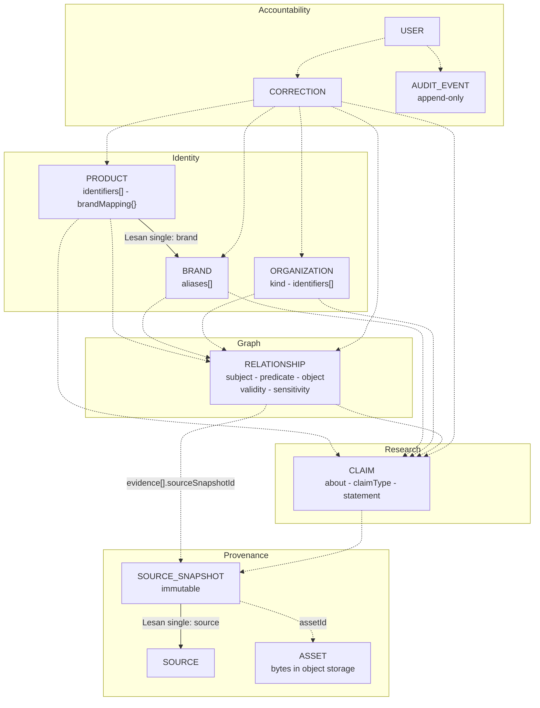

# Consumer Transparency Platform
## Domain ERD & Document Model — Canonical Specification

| Field | Value |
|---|---|
| **Document ID** | CT-DOMAIN-SPEC |
| **Version** | 3.1 |
| **Status** | Canonical baseline for implementation. Supersedes v1.0 (fa) and v2.0 (en) in full. |
| **Language** | English. All schema identifiers, enums and code in English. User-facing content must support Persian and be designed for multilingual extension. |
| **Target stack** | MongoDB + Lesan + Deno + TypeScript |
| **Source of truth** | Code (schema/validators) is the source of truth; this document is the contract for that code. |
| **Audience** | Product owner, domain researchers, backend/frontend developers, AI coding agents |

---

## 0. How to Use This Document

This is the **only** authoritative domain-model specification. If it conflicts with any other file, this document wins.

Three decision levels:

- **LOCKED** — decided. An agent may not change it. Change requires a new ADR.
- **PROVISIONAL** — implement it, but measure and report during the Architecture Spike.
- **DEFERRED** — do not implement. Creating collections or fields for it is forbidden.

**Golden rule for agents: if it is not in this document, it does not exist.** If something is needed, write an ADR first, then code.

**Agent pre-flight (mandatory before any code change):**

1. Read the whole repository: `AGENTS.md`, backend guides, `deno.json`, `deno.lock`, `mod.ts`, existing models, actions, MongoDB connection method.
2. Read the **actually installed** Lesan version from the lockfile. Never guess the API from memory, old examples, or this document. Verify `newModel`, relations, `insertOne`, `updateOne`, `addRelation`, `removeRelation`, `selectStruct` and type generation against that version.
3. If a similar model or collection already exists, inspect it before creating a new one. No duplicate models, no destructive migrations.
4. Report the current structure, the delta against this document, and a small staged change plan **before** writing code.
5. At the end, report: files changed, collections created, indexes, tests run, tests failed, and anything requiring a human decision.

---

## 1. Invariants Card (non-negotiable — each must have an executable test)

These 15 rules override every other decision. Each must have an automated test named after its invariant ID.

| ID | Rule | Minimum test |
|---|---|---|
| **I01** | `Product != Brand != Organization`; Importer is a role, not an identity | Creating a Product with an `owner` field is rejected |
| **I02** | `UNKNOWN != FALSE`; `NOT_SUPPORTED` is not the negation of the proposition | No code path converts an outcome into a negative boolean |
| **I03** | `review != assessment != publication != legal != campaign` | No combined field or single badge is produced |
| **I04** | Public projection never returns internal data | Test every role x every internal field |
| **I05** | `SUPPORTED` requires >=1 EvidenceLink and `assessedBy != createdBy` | Self-assessment attempt -> 403 |
| **I06** | `PUBLISHED` requires `publicationGate.result = PASS` | Direct transition -> 409 |
| **I07** | SENSITIVE/HIGH_RISK finding: author != assessor != publisher | All three identical -> 403 |
| **I08** | SourceSnapshot is immutable | Any update to snapshot content identity -> reject |
| **I09** | AuditEvent is append-only | update/delete -> reject at repository level |
| **I10** | Correction never applies a raw patch | `proposedValue` as free `$set` -> reject |
| **I11** | No transitive ownership/control inference without a written methodology | No multi-hop traversal in the public API |
| **I12** | No universal score, color or badge is produced | No `score` field in any projection |
| **I13** | All identifiers are `string`; leading zeros preserved | GTIN with leading zero round-trips |
| **I14** | All array caps enforced in validators | Exceeding a cap -> 422, never silent discard |
| **I15** | Identity merge = tombstone + redirect; historical references never rewritten | After merge, historical documents still carry the old ID |

---

## 2. MVP Scope — Domain Decision (LOCKED)

### 2.1 The vertical slice that must be built

```
Scan / enter identifier
  -> normalize per scheme
  -> Resolution (FOUND | NOT_FOUND | AMBIGUOUS | DISPUTED | UNVERIFIED)
  -> Product + brandMapping state
  -> Brand
  -> published Relationships (Product-level and Brand-level)
  -> published Claims
  -> Evidence + Source + dates + limitations
  -> explicit unknowns
```

**This is the only path that must work in the MVP.** Everything outside it is DEFERRED unless explicitly listed in 2.2.

### 2.2 Eleven core collections (LOCKED)

```
products
brands
organizations
relationships
claims
sources
source_snapshots
assets
corrections
users
audit_events
```

`assets` is core because uploads and captures exist from day one.

### 2.3 Reductions relative to v2 (LOCKED)

| Item | v3.1 decision | Rationale |
|---|---|---|
| `categories` | **DEFERRED.** `categoryCode: string` + `taxonomy.v1.json` in the repo | Building a full taxonomy before having products is premature scope: materialized paths, cycle detection and subtree-move tests are cost without MVP benefit |
| Lesan relation `Product -> Category` | **Removed** | Consequence of the above |
| Predicates | **Five** (6.2) | Every extra predicate is another consistency surface |
| `SUBSIDIARY_OF` | **Removed**; derived at read time as the inverse label of OWNS/CONTROLS | Prevents `A OWNS B` + `A SUBSIDIARY_OF B` contradictions |
| `OPERATES`, `SUPPLIES`, `EXPORTS_TO_MARKET`, `LICENSES`, `FRANCHISES` | **DEFERRED** | Semantics and evidence requirements are not yet precise |
| Claim types | **Three** (7.2) | All others rejected |
| `OTHER_REVIEWED_TYPE`, `OTHER_REVIEWED` | **Removed entirely** | Every OTHER in a canonical enum is a governance leak |
| `PublicationState.visibilityScope` | **Removed entirely** | Ambiguous cross-product with status; an authorization-bug source |
| `Source.latestSnapshotId` | **Removed**; `lastCapturedAt` + reverse preview only | Two sources of truth for one fact |
| `SourceSnapshot.version` | **Removed** | An immutable document has no mutable version |
| `attributes: Record<string, unknown>` | **Removed**; typed array with a small global registry | Free JSON is permanent debt |

### 2.4 Additions in v3 / v3.1 (LOCKED)

`sensitivity` on findings; `publicationGate`; `responseSolicitations[]` (right of reply); `publicWording`; merge/redirect; redaction lineage; `idempotencyKey`; controlled `limitations`; `publicCorrectionNotice`; public-profile read model; profile assembly contract; Persian normalization algorithm; **data-acquisition layer with verified tooling (18)**; **research operations model (19)**.

---

## 3. Topology and Document Ownership



```
PRODUCT      |-- identifiers[] - localizedNames[] - attributes[] - brandMapping{} - brand (Lesan)
BRAND        |-- aliases[] - localizedNames[] - productsPreview[] (bounded Lesan reverse)
ORGANIZATION |-- aliases[] - localizedNames[] - identifiers[] - legalProfile{}
RELATIONSHIP |-- subject / predicate / object - context{} - validity{}
             |-- sensitivity - review{} - assessment{} - publication{} - publicationGate{}
             |-- evidence[] - organizationResponses[] - responseSolicitations[]
             |-- researchNotes[] - recentRevisionPreview[]
CLAIM        |-- about - relatedEntities[] - claimType - statement - publicWording
             |-- scope{} - structuredValue (discriminated union)
             |-- (same subdocuments as RELATIONSHIP)
SOURCE       |-- recentSnapshotsPreview[] (bounded Lesan reverse)
SNAPSHOT     |-- source (Lesan) - assetId - redaction{} - supersedesSnapshotId
CORRECTION   |-- target{} - proposedChange{} - evidenceReferences[] - review{} - application{}
ASSET        |-- storage + processing metadata
USER         |-- minimal account data
AUDIT_EVENT  |-- immutable event
```

**Rule:** no complete list is ever embedded in a parent document. Lesan reverse snapshots are bounded previews only; complete lists and counts always query the owning collection.

---

## 4. Shared Types

### 4.1 Closed entity registry (LOCKED)

```ts
type EntityType =
  | "PRODUCT" | "BRAND" | "ORGANIZATION"
  | "RELATIONSHIP" | "CLAIM"
  | "SOURCE" | "SOURCE_SNAPSHOT" | "ASSET"
  | "CORRECTION" | "USER";

type EntityRef<T extends EntityType = EntityType> = { type: T; id: ObjectId };

type RelationshipEndpointType = "PRODUCT" | "BRAND" | "ORGANIZATION";
type ClaimAboutType           = "PRODUCT" | "BRAND" | "ORGANIZATION" | "RELATIONSHIP";
type CorrectionTargetType     = "PRODUCT" | "BRAND" | "ORGANIZATION"
                              | "RELATIONSHIP" | "CLAIM" | "SOURCE" | "SOURCE_SNAPSHOT";
type AuditTargetType          = EntityType; // all, including USER and ASSET
```

v2 defined `EntityType` with only four members while Correction and Audit referenced eight types. **That inconsistency is resolved here.** No free strings, collection names or model names are accepted from a client. Resolution happens only through a server-side registry.

### 4.2 Time

```ts
type Validity = {
  validFrom?: Date | null;
  validTo?: Date | null;
  datePrecision: "EXACT" | "MONTH" | "YEAR" | "APPROXIMATE" | "UNKNOWN";
};
```

Half-open interval `[validFrom, validTo)`. Unknown dates stay `null`; never guess exact dates from vague wording. `validTo: null` means "no end recorded," **not** "still true today." Public display must state the difference.

`validity` (real-world time) is separate from `recordedAt` / `createdAt` / `updatedAt` (system time).

### 4.3 Common metadata

```ts
type DocMeta = {
  _id: ObjectId;
  schemaVersion: number;
  version: number;          // optimistic concurrency
  createdAt: Date; updatedAt: Date;
  createdBy?: ObjectId; updatedBy?: ObjectId;
};
```

Snapshots and AuditEvents do not carry this (immutable). All dates are UTC BSON Date; Jalali conversion happens in the UI only.

### 4.4 Shared identity helper types

```ts
type Alias = {
  _id: ObjectId;
  value: string;
  normalizedValue: string;   // per 13.1
  matchKey: string;          // per 13.1
  locale?: string;
  sourceSnapshotId?: ObjectId;
};

type LocalizedName = { locale: string; value: string };

type IdentityProvenance = {
  sourceSnapshotIds?: ObjectId[];
  lastVerifiedAt?: Date;
  verifiedBy?: ObjectId;
};

type Sensitivity = "ROUTINE" | "SENSITIVE" | "HIGH_RISK";
```

`Sensitivity` classification rules and required evidence are defined in 10.6. It is a **publication-risk classification**, not a moral or legal judgment.

### 4.5 Hard caps (LOCKED — enforced in validators, not prose)

| Path | Cap |
|---|---|
| `identifiers[]` | 20 |
| `aliases[]` | 50 |
| `localizedNames[]` | 10 |
| `attributes[]` | 40 |
| `evidence[]` | 50 |
| `organizationResponses[]` | 20 |
| `responseSolicitations[]` | 10 |
| `researchNotes[]` | 100 |
| `recentRevisionPreview[]` | 20 |
| `relatedEntities[]` / `evidenceReferences[]` | 10 |
| `excerpt` / `statement` / `publicWording` / `rationale` | 2,000 chars |
| `responseText` | 10,000 chars |
| `noteBody` | 4,000 chars |
| `captureMetadata` | 20 allowlisted keys, depth <= 2 |

Exceeding a cap -> `422 CAP_EXCEEDED`. **Never silent `$slice`.** Real growth requires an ADR for a split.

### 4.6 Merge and redirect (LOCKED)

```ts
type Mergeable = {
  lifecycle: "ACTIVE" | "INACTIVE" | "ARCHIVED" | "MERGED";
  mergedIntoId?: ObjectId;
  mergedAt?: Date; mergedBy?: ObjectId; mergeReason?: string;
};
```

Rules:

1. A merge never rewrites historical references. The old document remains as a tombstone.
2. `entityResolver.resolve(ref)` follows the `mergedIntoId` chain: max depth 5, cycle detection. A cycle -> error + admin flag.
3. Public reads redirect to the survivor with a notice: "this record was merged into X."
4. Unmerge is possible: AuditEvent + lifecycle restoration. Rare.
5. Merging two identities with contradictory official identifiers is blocked and requires a human decision.

---

## 5. Identity

### 5.1 `products`

```ts
type ProductIdentifier = {
  _id: ObjectId;
  scheme: "GTIN" | "IR_PRODUCT_ID" | "IR_TRACKING_ID"
        | "TAX_PRODUCT_SERVICE_ID" | "HS_CODE" | "IRC" | "TTAC_UID" | "SKU";
  value: string;              // raw, leading zeros preserved
  normalizedValue: string;    // per 13.2
  matchValue?: string;        // GTIN: zero-padded to 14 digits
  jurisdiction?: string;
  issuer?: string;
  status: "UNVERIFIED" | "VERIFIED" | "DISPUTED" | "RETIRED";
  sourceSnapshotIds?: ObjectId[];
  validFrom?: Date | null; validTo?: Date | null;
};

type ProductAttributeKey =
  | "DECLARED_ORIGIN" | "INGREDIENTS_TEXT" | "MANUFACTURER_ON_PACKAGE"
  | "IMPORTER_ON_PACKAGE" | "NET_CONTENT_TEXT";

type ProductDocument = DocMeta & Mergeable & {
  name: string;
  normalizedName: string;     // 13.1
  matchKey: string;           // 13.1
  localizedNames?: LocalizedName[];
  description?: string;
  identifiers: ProductIdentifier[];
  categoryCode?: string;      // from taxonomy.v1.json; no collection
  brand?: BrandRelationSnapshot;   // Lesan single, optional
  brandMapping: {
    status: "UNREVIEWED" | "CANDIDATE" | "VERIFIED" | "DISPUTED" | "REJECTED";
    candidateBrandId?: ObjectId;
    rationale?: string;
    reviewedAt?: Date; reviewedBy?: ObjectId;
    evidenceSnapshotIds?: ObjectId[];
  };
  identityProvenance?: IdentityProvenance;
  packaging?: {
    netContentValue?: number; netContentUnit?: string;
    packCount?: number; packageType?: string; variant?: string;
  };
  attributes?: Array<{
    key: ProductAttributeKey;
    value: string | number | boolean;
    unit?: string; locale?: string;
    sourceSnapshotId?: ObjectId;
  }>;
};
```

Domain rules:

- GTIN stored as string; validate length (8/12/13/14) and check digit.
- **A GS1 prefix is never used to infer manufacturing country, company nationality, ownership, or ethical/legal status.**
- `brandMapping.candidateBrandId` is a proposal; only an approved mapping populates `brand`.
- A Product may temporarily have no verified brand. Default state is `UNREVIEWED`, not empty.
- Multi-brand and multi-category are unsupported in the MVP; return an explicit error rather than overloading fields.
- A 200 g jar and a 500 g jar with different GTINs are different Products.

### 5.2 `brands`

```ts
type BrandDocument = DocMeta & Mergeable & {
  name: string; normalizedName: string; matchKey: string;
  localizedNames?: LocalizedName[];
  aliases: Alias[];
  description?: string; website?: string; logoAssetId?: ObjectId;
  identityProvenance?: IdentityProvenance;
};
```

**No `ownerId` field exists on Brand.** Ownership comes only from `relationships`.

### 5.3 `organizations`

```ts
type OrganizationIdentifier = {
  _id: ObjectId;
  scheme: "NATIONAL_ID" | "REGISTRATION_NUMBER" | "LEI" | "TAX_ID";
  value: string; normalizedValue: string;
  jurisdiction?: string; issuer?: string;
  status: "UNVERIFIED" | "VERIFIED" | "DISPUTED" | "RETIRED";
  sourceSnapshotIds?: ObjectId[];
};

type OrganizationDocument = DocMeta & Mergeable & {
  name: string; normalizedName: string; matchKey: string;
  localizedNames?: LocalizedName[];
  kind: "CORPORATE_GROUP" | "LEGAL_ENTITY" | "GOVERNMENT_BODY"
      | "PUBLIC_INSTITUTION" | "NON_PROFIT" | "RETAILER" | "OTHER";
  aliases: Alias[];
  identifiers: OrganizationIdentifier[];
  legalProfile?: {
    jurisdiction?: string; legalForm?: string;
    incorporationDate?: Date;
    registeredAddress?: string;   // access-controlled; never in public projection
  };
  website?: string;
  operatingCountryCodes?: string[];
  identityProvenance?: IdentityProvenance;
  description?: string;
};
```

Domain rules:

- A corporate group and its subsidiary legal entities are separate documents; their connection is a Relationship.
- An organization name is not a unique identifier.
- **Name similarity, a shared address, or a shared director is not evidence of ownership.**
- Importer / Manufacturer / Distributor are roles in Relationships, not identity types.
- A brand's country of origin, an organization's registration jurisdiction, and a product's manufacturing origin are three different facts.

---

## 6. `relationships`

### 6.1 Structure

```ts
type RelationshipPredicate =
  | "OWNS" | "CONTROLS" | "MANUFACTURES" | "DISTRIBUTES" | "IMPORTS_TO_MARKET";

type RelationshipDocument = DocMeta & {
  subject: EntityRef<RelationshipEndpointType>;
  predicate: RelationshipPredicate;
  predicateRegistryVersion: number;   // = 1
  object: EntityRef<RelationshipEndpointType>;
  context?: {
    marketCountryCode?: string;
    jurisdiction?: string;
    ownership?: {
      sharePercentage?: number;
      basis?: "DIRECT" | "INDIRECT" | "VOTING_RIGHTS" | "OTHER_DOCUMENTED";
      notes?: string;
    };
    notes?: string;
  };
  validity: Validity;
  sensitivity: Sensitivity;
  recordLifecycle: "ACTIVE" | "ARCHIVED";
  review: ReviewWorkflow;
  assessment: EvidenceAssessment;
  publication: PublicationState;
  publicationGate?: PublicationGate;
  publicWording?: string;              // required for PUBLISHED
  evidence: EvidenceLink[];
  organizationResponses: OrganizationResponse[];
  responseSolicitations: ResponseSolicitation[];
  researchNotes: ResearchNote[];
  recentRevisionPreview: RevisionPreview[];
  canonicalKey?: string;               // helper; not unique
  recordedAt: Date;
};
```

### 6.2 Five-predicate registry (LOCKED)

| Predicate | Subject | Object | Meaning / direction | Required context | Derived inverse label |
|---|---|---|---|---|---|
| `OWNS` | ORGANIZATION | ORGANIZATION \| BRAND | Subject owns object. Record share and basis when documented. Ownership != operational control | — | "owned by" |
| `CONTROLS` | ORGANIZATION | ORGANIZATION \| BRAND | Subject exercises documented control. The basis must be explicit | `ownership.basis` | "controlled by" |
| `MANUFACTURES` | ORGANIZATION | PRODUCT | Subject manufactures object | — | "manufactured by" |
| `DISTRIBUTES` | ORGANIZATION | PRODUCT \| BRAND | Subject distributes object | `marketCountryCode` | "distributed by" |
| `IMPORTS_TO_MARKET` | ORGANIZATION | PRODUCT | Subject imports the product into the named market | `marketCountryCode` | "imported by" |

`SUBSIDIARY_OF` does not exist. If `A OWNS B` or `A CONTROLS B` is published, the UI for B may render "a subsidiary of A" — a **derived read-time label**, not a separate document.

### 6.3 Historical and duplicate rules

Owner change = **a new edge**. Never rewrite the subject of an existing document.

```
A --OWNS--> B  [2019-01-01, 2023-01-01)  recordLifecycle: ACTIVE
C --OWNS--> B  [2023-01-01, null)        recordLifecycle: ACTIVE
```

Real-world end = `validity.validTo`. Platform withdrawal = `recordLifecycle: ARCHIVED`. Public retraction = `publication: RETRACTED`. **Three separate concepts.** (v1 used `ENDED`/`RETRACTED` in lifecycle; removed in v3.)

**Overlap != duplicate.** A 50/50 joint venture legitimately has two overlapping `OWNS` edges. Overlap detection produces a **review flag only** — never a rejection, and never a general unique index.

`canonicalKey = subject.type|subject.id|predicate|object.type|object.id|normalizedContextScope` — for idempotency and duplicate suggestions only. A unique index on it is **forbidden** until a written domain decision exists.

**I11:** no automatic multi-hop traversal in the public API. `A OWNS B` + `B OWNS C` does not license publishing "A has ultimate control of C."

---

## 7. `claims`

### 7.1 Structure

```ts
type ClaimType = "MARKET_PRESENCE" | "PRODUCT_ORIGIN" | "OFFICIAL_STATEMENT";

type ClaimDocument = DocMeta & {
  about: EntityRef<ClaimAboutType>;
  relatedEntities?: EntityRef<RelationshipEndpointType>[];  // <= 10
  claimType: ClaimType;
  claimTypeRegistryVersion: number;  // = 1
  statement: string;                 // precise internal proposition
  publicWording?: string;            // required for PUBLISHED
  localizedStatements?: LocalizedName[];
  structuredValue: ClaimStructuredValue;   // discriminated union
  scope?: { marketCountryCode?: string; jurisdiction?: string } & Partial<Validity>;
  sensitivity: Sensitivity;
  recordLifecycle: "ACTIVE" | "ARCHIVED";
  review: ReviewWorkflow;
  assessment: EvidenceAssessment;
  publication: PublicationState;
  publicationGate?: PublicationGate;
  evidence: EvidenceLink[];
  organizationResponses: OrganizationResponse[];
  responseSolicitations: ResponseSolicitation[];
  researchNotes: ResearchNote[];
  recentRevisionPreview: RevisionPreview[];
  recordedAt: Date;
};
```

### 7.2 Three-type registry (LOCKED)

```ts
type ClaimStructuredValue =
  | { claimType: "MARKET_PRESENCE";
      marketCountryCode: string;
      channel?: "RETAIL" | "ONLINE" | "WHOLESALE" | "UNKNOWN";
      observationBasis: "OFFICIAL_LIST" | "RETAILER_LISTING" | "PACKAGE_LABEL" | "REPORTED"; }
  | { claimType: "PRODUCT_ORIGIN";
      declaredOriginCountryCode: string;
      declarationSurface: "PACKAGE" | "OFFICIAL_REGISTRY" | "COMPANY_STATEMENT";
      conflictsWithSnapshotId?: ObjectId; }
  | { claimType: "OFFICIAL_STATEMENT";
      speakingOrganizationId: ObjectId;
      statementDate?: Date | null;
      statementDatePrecision: Validity["datePrecision"];
      channel: "PRESS_RELEASE" | "SOCIAL" | "INTERVIEW" | "FILING" | "OTHER_DOCUMENTED"; };
```

Any other type is rejected. `OTHER_REVIEWED_TYPE` does not exist.

### 7.3 Claim/Relationship boundary lint (LOCKED)

When creating a Claim, if `structuredValue` has the shape of a permitted edge (e.g. ownership between two Organizations), the server returns `409 USE_RELATIONSHIP_INSTEAD` with a suggested payload. This prevents researcher drift.

---

## 8. Provenance

### 8.1 `sources`

```ts
type SourceDocument = DocMeta & {
  title: string;
  canonicalUrl?: string;         // after canonicalization, 13.3
  sourceType: "OFFICIAL_REGISTRY" | "GOVERNMENT_DOCUMENT" | "LEGAL_INSTRUMENT"
            | "COMPANY_DOCUMENT" | "RESEARCH_REPORT" | "NEWS" | "ACADEMIC"
            | "DATASET" | "OTHER";
  publisherName?: string;
  publisherOrganizationId?: ObjectId;
  publisherVerified: boolean;    // an official-looking domain != an official publisher
  language?: string; countryCode?: string; jurisdiction?: string;
  access: "PUBLIC" | "RESTRICTED" | "INTERNAL";
  usageTerms?: string;
  licenseCode?: string;          // e.g. ODbL-1.0 for ingested datasets
  attributionRequired: boolean;
  lifecycle: "ACTIVE" | "UNAVAILABLE" | "ARCHIVED";
  lastCapturedAt?: Date;
};
```

**No universal reliability score exists for a Source.** Instead: type, publisher, dates, `limitations`, and the reviewer's reasoning.

### 8.2 `source_snapshots` — immutable (I08)

```ts
type AcquisitionTier =
  | "A_OFFICIAL_MACHINE_READABLE"
  | "B_OFFICIAL_PUBLIC_LOOKUP"
  | "C_OFFICIAL_AUTHENTICATED_ACCESS"
  | "D_FORMAL_INFORMATION_REQUEST"
  | "E_RESEARCH_OR_COMMUNITY";

type SourceSnapshotDocument = {
  _id: ObjectId;
  schemaVersion: number;
  // no version field — immutable
  source: SourceRelationSnapshot;        // Lesan single
  titleAtCapture?: string;
  canonicalUrlAtCapture?: string;
  publishedAt?: Date | null;             // never guessed from retrievedAt
  retrievedAt: Date;
  contentHash: string;                   // SHA256 of the ORIGINAL bytes
  hashAlgorithm: "SHA256";
  mimeType?: string; byteSize?: number;
  assetId?: ObjectId;                    // original bytes
  captureMethod: "MANUAL" | "CRAWLER" | "API" | "UPLOAD";
  acquisitionTier: AcquisitionTier;
  capturedBy?: ObjectId;
  captureMetadata?: Record<string, string | number | boolean>;
  supersedesSnapshotId?: ObjectId;       // metadata correction -> new document
  supersededBySnapshotId?: ObjectId;     // advisory
  redaction?: {
    redactedAssetId: ObjectId;
    reason: string;
    redactedAt: Date; redactedBy: ObjectId;
    method: "PIXEL" | "TEXT_REMOVAL" | "PAGE_REMOVAL";
    originalRetained: true;              // original always retained, restricted
  };
  lifecycle: "AVAILABLE" | "UNAVAILABLE" | "ARCHIVED";
  createdAt: Date;
};
```

Key rules:

- **Snapshot = the capture event. Asset = the bytes.** Two snapshots with identical content may share one asset. That is correct, not duplication.
- A metadata correction creates a new snapshot with `supersedesSnapshotId`. The old document is untouched.
- EvidenceLinks stay pinned to **the exact snapshot cited**. Supersession is advisory and shown in the UI: "a corrected metadata record exists."
- `REDACTED` is no longer a lifecycle value; it is a `redaction` subdocument. `contentHash` always hashes the **original**; served bytes may be redacted, and the UI must say so.
- A restricted snapshot never becomes public merely because a Claim citing it is published.

### 8.3 `assets`

```ts
type AssetDocument = {
  _id: ObjectId; schemaVersion: number; version: number;
  storage: { provider: "S3_COMPATIBLE" | "LOCAL_DEV"; bucket?: string; objectKey: string };
  originalFileName?: string; safeDisplayName?: string;
  mimeType: string; byteSize: number; sha256: string;
  processingStatus: "QUARANTINED" | "SCANNING" | "READY" | "REJECTED";
  visibility: "PRIVATE" | "RESEARCH_ONLY" | "PUBLIC_APPROVED";
  uploadedBy?: ObjectId; uploadedAt: Date;
  malwareScan?: { engine?: string; result: "CLEAN" | "INFECTED" | "ERROR"; scannedAt: Date };
  exifStripped: boolean;
  retentionUntil?: Date;
  legalHold: boolean;
  lifecycle: "ACTIVE" | "ARCHIVED" | "DELETED_PENDING_PURGE";
};
```

Validate MIME by inspecting bytes, not filename or client headers. Quarantine until scanning completes. Short-lived authorized download URLs. Object keys never reach the client. `legalHold = true` blocks purge.

---

## 9. Governance

### 9.1 `corrections`

```ts
type CorrectionDocument = DocMeta & {
  target?: EntityRef<CorrectionTargetType>;   // absent only for valid ADD_MISSING
  submissionKind: "CORRECT_EXISTING" | "ADD_MISSING" | "RETRACT" | "REPORT_ISSUE";
  proposedChange?: {
    fieldKey: string;                          // allowlist per targetType
    operation: "SET" | "UNSET" | "ADD_RELATIONSHIP" | "END_RELATIONSHIP";
    proposedValue?: unknown;                   // schema per (targetType, fieldKey)
    proposedEntity?: EntityRef<RelationshipEndpointType>;
  };
  reason: string;
  evidenceReferences: Array<{
    sourceSnapshotId?: ObjectId; assetId?: ObjectId; url?: string; note?: string;
  }>;
  submittedBy: ObjectId; submittedAt: Date;
  idempotencyKey: string;                      // unique per submitter
  status: "PENDING" | "IN_REVIEW" | "NEEDS_INFORMATION"
        | "APPROVED" | "REJECTED" | "WITHDRAWN";
  review: {
    assignedTo?: ObjectId; reviewedBy?: ObjectId;
    reviewedAt?: Date; decisionReason?: string;
  };
  application?: {
    appliedAt?: Date; appliedBy?: ObjectId;
    targetVersionBefore?: number; targetVersionAfter?: number;
    result: "APPLIED" | "FAILED" | "NOT_APPLICABLE";
    failureReason?: string;
    idempotencyKey: string;                    // unique — prevents double application
  };
};
```

`APPROVED != APPLIED`. Application happens only through a domain action with authorization, expectedVersion, idempotency and an AuditEvent. `OTHER_REVIEWED` is removed.

### 9.2 `users`

```ts
type UserRole = "CONTRIBUTOR" | "RESEARCHER" | "RESEARCH_REVIEWER"
              | "LEGAL_REVIEWER" | "MODERATOR" | "ADMIN";

type UserDocument = DocMeta & {
  authProvider: string; authSubject: string;
  email?: string; emailNormalized?: string; phone?: string;   // private
  displayName?: string; preferredLocale?: string;
  roles: UserRole[];
  trustLevel: "NEW" | "REGULAR" | "TRUSTED";
  accountStatus: "PENDING" | "ACTIVE" | "SUSPENDED" | "CLOSED";
  lastActiveAt?: Date;
};
```

`RESEARCH_REVIEWER` is restored (v2 had removed it) — without it, I05/I07 are unenforceable.

Guests need no account to scan or search. Scan history is not stored server-side. PII lives only in `users`; Audit carries only `actor.id`, so account deletion never requires mutating Audit.

A trust level is not an authorization role.

### 9.3 `audit_events`

```ts
type AuditAction =
  // identity
  | "ENTITY_CREATED" | "ENTITY_UPDATED" | "ENTITY_ARCHIVED"
  | "ENTITY_MERGED" | "ENTITY_UNMERGED"
  | "IDENTIFIER_ADDED" | "IDENTIFIER_STATUS_CHANGED"
  | "BRAND_MAPPING_REVIEWED" | "BRAND_RELATION_CHANGED"
  // findings
  | "RELATIONSHIP_CREATED" | "RELATIONSHIP_CLOSED"
  | "CLAIM_CREATED"
  | "REVIEW_STATUS_CHANGED" | "ASSESSMENT_RECORDED"
  | "PUBLICATION_GATE_EVALUATED" | "PUBLICATION_CHANGED"
  | "PUBLIC_WORDING_CHANGED" | "FINDING_RETRACTED"
  | "GATE_WAIVER_GRANTED"
  // evidence & responses
  | "EVIDENCE_ADDED" | "EVIDENCE_REMOVED" | "EVIDENCE_REVIEWED"
  | "SOURCE_CREATED" | "SNAPSHOT_CREATED" | "SNAPSHOT_SUPERSEDED"
  | "SNAPSHOT_REDACTED"
  | "SOLICITATION_SENT" | "SOLICITATION_OUTCOME_RECORDED"
  | "ORG_RESPONSE_ADDED" | "ORG_RESPONSE_PUBLICATION_CHANGED"
  // assets
  | "ASSET_UPLOADED" | "ASSET_SCAN_COMPLETED" | "ASSET_PURGED"
  // governance
  | "CORRECTION_SUBMITTED" | "CORRECTION_REVIEWED" | "CORRECTION_APPLIED"
  | "USER_ROLES_CHANGED" | "USER_TRUST_CHANGED" | "USER_STATUS_CHANGED"
  | "USER_PII_PURGED";

type AuditEventDocument = {
  _id: ObjectId; eventSchemaVersion: number;
  actor: { type: "USER" | "SYSTEM" | "SERVICE"; id?: ObjectId };
  action: AuditAction;
  target: EntityRef<AuditTargetType>;
  requestId?: string; correlationId?: string;
  idempotencyKey?: string;
  targetVersionBefore?: number; targetVersionAfter?: number;
  changedPaths?: string[];
  beforeSummary?: Record<string, string | number | boolean | null>;
  afterSummary?: Record<string, string | number | boolean | null>;
  reason?: string;
  occurredAt: Date;
};
```

**Allowlist per action, deny by default.** Never record: `email`, `phone`, `authSubject`, `passwordHash`, `registeredAddress`, `researchNotes` bodies, tokens, or full document copies. Nested values and arrays are forbidden in summaries (enforced by the flat type above).

Append-only enforced at the repository level, not only in prose.

---

## 10. Shared Embedded Contracts

### 10.1 EvidenceLink

```ts
type EvidenceLink = {
  _id: ObjectId;
  sourceSnapshotId: ObjectId;
  stance: "SUPPORTS" | "CONTRADICTS" | "CONTEXTUALIZES" | "NEUTRAL";
  locator?: {
    page?: number; section?: string; paragraph?: string;
    timestamp?: string; urlFragment?: string;
  };
  excerpt?: string;         // <= 2,000 chars
  rationale?: string;
  addedBy: ObjectId; addedAt: Date;
  reviewedBy?: ObjectId; reviewedAt?: Date;
};
```

Stance belongs to the **link**, not to the Source. One passage may support one proposition and contradict another. Excerpts must respect copyright, licensing and privacy.

### 10.2 ReviewWorkflow (work in progress)

```ts
type ReviewWorkflow = {
  status: "NOT_QUEUED" | "QUEUED" | "IN_REVIEW" | "NEEDS_INFORMATION"
        | "READY_FOR_DECISION" | "CLOSED";
  assignedTo?: ObjectId;
  priority: "LOW" | "NORMAL" | "HIGH" | "URGENT";
  openedAt?: Date; lastActionAt?: Date; closedAt?: Date;
};
```

### 10.3 EvidenceAssessment (outcome)

```ts
type LimitationCode =
  | "SELF_REPORTED" | "SINGLE_SOURCE" | "OUTDATED" | "TRANSLATED"
  | "PAYWALLED" | "UNVERIFIED_PUBLISHER" | "PARTIAL_SCOPE"
  | "INDIRECT_INFERENCE" | "SECONDARY_REPORTING";

type EvidenceAssessment = {
  outcome: "NOT_ASSESSED" | "SUPPORTED" | "PARTIALLY_SUPPORTED"
         | "NOT_SUPPORTED" | "DISPUTED" | "INCONCLUSIVE";
  summary?: string;
  assessedAt?: Date; assessedBy?: ObjectId;
  methodologyVersion: string;      // points to docs/methodology.md
  limitations: LimitationCode[];
};
```

Definitions:

- `SUPPORTED` — reviewed evidence supports the precisely worded proposition within its stated scope and dates.
- `PARTIALLY_SUPPORTED` — only part is supported; public wording must be narrowed.
- `NOT_SUPPORTED` — available evidence does not support the proposition. **This does not prove its opposite.**
- `DISPUTED` — credible evidence or interpretations materially conflict. Not merely a user disagreeing.
- `INCONCLUSIVE` — insufficient evidence for a defensible conclusion.
- `NOT_ASSESSED` — no conclusion reached.

### 10.4 PublicationState (visibility decision)

```ts
type PublicationState = {
  status: "DRAFT" | "PENDING_REVIEW" | "PUBLISHED" | "WITHHELD" | "RETRACTED";
  decidedBy?: ObjectId; decidedAt?: Date; publishedAt?: Date;
  retractedAt?: Date; retractionReason?: string;
  reason?: string;
};
```

`visibilityScope` is **removed**. Internal access is governed by roles and projections, not by this enum.

Transition truth table:

| from \ to | DRAFT | PENDING_REVIEW | PUBLISHED | WITHHELD | RETRACTED |
|---|---|---|---|---|---|
| DRAFT | — | yes (RESEARCHER) | no | yes (RESEARCHER) | no |
| PENDING_REVIEW | yes | — | yes (Gate PASS only) | yes | no |
| PUBLISHED | no | no | — | yes | yes |
| WITHHELD | yes | yes | yes (Gate PASS only) | — | no |
| RETRACTED | no | yes (re-review) | no | no | — |

### 10.5 PublicationGate (LOCKED — new)

```ts
type PublicationGate = {
  gateVersion: string;         // "1"
  evaluatedAt: Date;
  sensitivity: Sensitivity;
  checks: {
    evidenceCountOk: boolean;
    independentSourcesOk: boolean;
    assessmentOk: boolean;          // SUPPORTED, or PARTIALLY_SUPPORTED with narrowed wording
    fourEyesOk: boolean;            // createdBy != assessedBy != decidedBy
    legalSignOffOk: boolean;
    rightOfReplyOk: boolean;
    publicWordingOk: boolean;       // publicWording present and approved
    sourceAccessOk: boolean;        // no restricted snapshot cited publicly
    noScoreOk: true;
  };
  result: "PASS" | "FAIL";
  failures: string[];
  waivers: Array<{
    check: string; reason: string; approvedBy: ObjectId; approvedAt: Date;
  }>;
};
```

Waivers are permitted only for `rightOfReplyOk` and `independentSourcesOk`, only by ADMIN, with a written reason and an AuditEvent. **`fourEyesOk` and `legalSignOffOk` can never be waived.**

### 10.6 Sensitivity and minimum-evidence matrix (LOCKED)

| Sensitivity | What | Minimum evidence | Required roles | Right of reply |
|---|---|---|---|---|
| `ROUTINE` | MANUFACTURES from package label; MARKET_PRESENCE from an official list | 1 verified snapshot | author != assessor | Not required |
| `SENSITIVE` | OWNS, CONTROLS, IMPORTS_TO_MARKET, DISTRIBUTES, conflicting PRODUCT_ORIGIN | 2 independent sources **or** 1 official registry snapshot (Tier A/B) | author != assessor != publisher | Required: response received **or** deadline elapsed |
| `HIGH_RISK` | Control chains, state/quasi-state linkage, any named natural person, any proposition with legal exposure | 2 independent sources including >=1 official | Four-eyes + LEGAL_REVIEWER sign-off | Required; waiver only with written ADMIN reason |

"Independent" means different publisher **and** different origin. Two republications of one wire story count as one source.

### 10.7 ResponseSolicitation — right of reply (LOCKED — new)

```ts
type ResponseSolicitation = {
  _id: ObjectId;
  organizationId: ObjectId;
  channel: "OFFICIAL_EMAIL" | "OFFICIAL_FORM" | "REGISTERED_MAIL"
         | "PUBLIC_CONTACT" | "OTHER";
  sentAt: Date; sentBy: ObjectId;
  assertionsSummary: string;        // exactly what we asked about
  responseDeadline: Date;           // default: sentAt + 14 days
  outcome: "PENDING" | "RESPONDED" | "NO_RESPONSE" | "DECLINED" | "UNDELIVERABLE";
  outcomeAt?: Date;
  proofAssetId?: ObjectId;          // sent email / postal receipt
  responseId?: ObjectId;            // -> organizationResponses[]._id
};
```

Without this record, "we asked and they did not reply" is unprovable. This is a legal-defensibility artifact, not a formality.

### 10.8 OrganizationResponse

```ts
type OrganizationResponse = {
  _id: ObjectId;
  respondingOrganizationId: ObjectId;
  responseText: string;             // <= 10,000 chars
  submittedAt: Date;
  receivedVia: "OFFICIAL_EMAIL" | "OFFICIAL_FORM" | "PUBLIC_STATEMENT" | "OTHER";
  sourceSnapshotId?: ObjectId;
  attachmentAssetIds?: ObjectId[];
  representativeVerification: {
    status: "UNVERIFIED" | "VERIFIED" | "DISPUTED";
    basis?: string; reviewedBy?: ObjectId; reviewedAt?: Date;
  };
  publicationStatus: "INTERNAL" | "PUBLIC_PENDING" | "PUBLIC" | "REDACTED";
  reviewedBy?: ObjectId; reviewedAt?: Date;
  solicitationId?: ObjectId;
};
```

A response is an **attributed position**; it never changes the assessment automatically. The organization's identity and the representative's authority are separate questions.

### 10.9 ResearchNote and RevisionPreview

```ts
type ResearchNote = {
  _id: ObjectId; authorId: ObjectId; body: string;
  visibility: "INTERNAL_RESEARCH" | "LEGAL_REVIEW" | "ADMIN_ONLY";
  createdAt: Date; updatedAt?: Date;
};

type RevisionPreview = {
  version: number; changedAt: Date; changedBy?: ObjectId;
  reason: string; changedFields: string[];
};
```

ResearchNotes never appear in a public projection under any role (I04).

---

## 11. Status Domains — Never Collapse Them

| Dimension | Question | Values |
|---|---|---|
| Record lifecycle | Is the platform record active? | ACTIVE, INACTIVE, ARCHIVED, MERGED |
| Validity | When was it true in the world? | validFrom / validTo |
| Review workflow | What work is happening? | QUEUED, IN_REVIEW, ... |
| Assessment | What does the evidence support? | SUPPORTED, PARTIALLY_SUPPORTED, ... |
| Publication | Is it public? | DRAFT, PUBLISHED, WITHHELD, RETRACTED |
| Legal (DEFERRED) | Under which law, jurisdiction, date? | Separate future vocabulary |
| Campaign (DEFERRED) | In which campaign, by whose criteria? | Separate future vocabulary |

Valid example: `assessment = SUPPORTED` + `publication = WITHHELD` because the source is restricted. That is not a contradiction; it is correct design.

---

## 12. Security, Privacy, Abuse, Retention

**Projections:** three levels — Public / Research / Admin — all enforced **server-side**. `selectStruct` only types the output shape; a client requesting a field never grants access. Test I04 must cover every role x every internal field.

**Fetcher (SSRF):** HTTPS required; block private, link-local, reserved and cloud-metadata addresses (`169.254.169.254`, `::1`, `10/8`, `172.16/12`, `192.168/16`, `fc00::/7`); revalidate after every redirect and every DNS resolution (anti-rebinding); max 3 redirects, 10 seconds, 10 MiB; never send ambient credentials.

**Abuse:** correction quota per user (10/day) and per IP (30/day); uploads 5/day and 20 MiB; content-hash dedup; detect coordinated dispute floods (multiple accounts, one target, short window) -> MODERATOR flag. `trustLevel` is not a rate limiter.

**Retention:** PII only in `users`. Account deletion purges PII and preserves `actor.id` in Audit. Assets in `DELETED_PENDING_PURGE` are purged by a scheduler after `retentionUntil` unless `legalHold`. Backups: oplog-based PITR + object versioning; monthly restore test.

**Retraction:** synchronous path — update document + read model + purge cache/CDN + remove from search index. **SLO: p95 < 60 seconds** until fully invisible across all public surfaces. Must be tested (S24).

---

## 13. Normalization and Entity Resolution

### 13.1 Persian name algorithm (LOCKED — implement exactly)

Two keys are produced: `normalizedName` (conservative, for display-adjacent dedup) and `matchKey` (aggressive, for candidate retrieval only).

```
normalizeName(input):
  1. NFKC
  2. Remove harakat: U+064B..U+0652, U+0670
  3. Remove tatweel: U+0640
  4. Letter folding:
       U+064A -> U+06CC
       U+0649 -> U+06CC
       U+0643 -> U+06A9
  5. Digit folding: U+0660..0669 and U+06F0..06F9 -> ASCII 0..9
  6. ZWNJ (U+200C) -> space
  7. Other Unicode separators (Zs, Zl, Zp) -> space
  8. Collapse whitespace + trim
  9. Lowercase (for Latin)
  -> normalizedName

matchKey(input):
  normalizeName(input), then:
  10. U+0629 -> U+0647
  11. U+0623 U+0625 U+0622 U+0671 -> U+0627
  12. U+0624 -> U+0648
  13. U+0626 -> U+06CC
  14. Remove U+0621
  15. Remove all whitespace and punctuation
  -> matchKey
```

**Mandatory test vectors:**

| Input | normalizedName | matchKey |
|---|---|---|
| `شركت پگاه ايران` | `شرکت پگاه ایران` | `شرکتپگاهایران` |
| `شرکت پگاه‌ایران` | `شرکت پگاه ایران` | `شرکتپگاهایران` |
| `پگاه  ` | `پگاه` | `پگاه` |
| `کاله ۱۲۳` | `کاله 123` | `کاله123` |
| `ميهن` | `میهن` | `میهن` |
| `دامدارانِ` | `دامداران` | `دامداران` |

`matchKey` is for **candidate retrieval only**. Merging two identities is never automatic.

### 13.2 Identifier normalization

- **GTIN:** strip spaces/hyphens, digits only, validate length and mod-10 check digit. `matchValue` = zero-padded to 14 digits. **Padding is a lookup key only; it never auto-merges distinct trade items.**
- **Iranian identifiers:** allow only the characters valid for that scheme, preserve leading zeros, never convert between schemes.
- **Never compare values from two different schemes.**
- GTIN reuse exists in the real world. A unique index on identifiers is **forbidden** until domain uniqueness is proven.

### 13.3 URL canonicalization

Lowercase host, remove default port, remove fragment, strip tracking parameters (`utm_*`, `gclid`, `fbclid`), normalize trailing slash per a written policy, IDN -> punycode, preserve https. Two canonicalized-equal URLs are not necessarily one Source — dedup is suggestive, never automatic.

### 13.4 Resolution contract

```ts
type ResolutionResult =
  | { state: "FOUND"; productId: ObjectId; confidence: "EXACT" }
  | { state: "NOT_FOUND" }
  | { state: "AMBIGUOUS"; candidates: Array<{ productId: ObjectId; reason: string }> }
  | { state: "DISPUTED"; productId: ObjectId; disputeNote: string }
  | { state: "UNVERIFIED"; productId: ObjectId };
```

**Never return an arbitrary match.** `NOT_FOUND` is a valid and useful answer.

### 13.5 Search

MongoDB text search has no Persian stemmer or stopwords. **Do not promise fuzzy Persian search on it.** MVP: exact `matchKey` + prefix on `normalizedName`. Evaluate Atlas Search / OpenSearch only against measured need.

---

## 14. Public Profile Assembly Contract (LOCKED — new)

This is the heart of the product and was absent from v1 and v2.

### 14.1 Inheritance rule

Findings are recorded mainly at Brand/Organization level, but users scan Products.

- **PRODUCT-level** finding: displayed directly, `scope: "PRODUCT"`.
- **BRAND-level** finding: displayed on all Products of that Brand with `scope: "BRAND"` and `inheritedFrom`. **The scope label must be visible in the UI.**
- **ORGANIZATION-level** finding: only if that Organization is connected through a **published** edge in the chain Product -> Brand -> Org.
- **Maximum depth: 2 hops. No automatic multi-hop traversal for ultimate-ownership conclusions (I11).**

### 14.2 Output shape

```ts
type PublicEvidenceView = {
  sourceTitle: string;
  publisherName?: string;
  capturedAt: Date;
  publishedAt?: Date | null;
  excerpt?: string;
  locator?: EvidenceLink["locator"];
  stance: EvidenceLink["stance"];
  publicSourceUrl?: string;
  isRedacted: boolean;
};

type PublicResponseView = {
  organizationName: string;
  responseText: string;
  submittedAt: Date;
  representativeVerified: boolean;
};

type PublicFindingView = {
  findingId: ObjectId;
  findingKind: "RELATIONSHIP" | "CLAIM";
  scope: "PRODUCT" | "BRAND" | "ORGANIZATION";
  inheritedFrom?: { type: EntityType; id: ObjectId; name: string };
  predicate?: RelationshipPredicate;
  claimType?: ClaimType;
  publicWording: string;
  counterparties: Array<{ type: EntityType; id: ObjectId; name: string }>;
  validity: Validity;
  assessmentOutcome: EvidenceAssessment["outcome"];
  limitations: LimitationCode[];
  publishedAt: Date;
  lastReviewedAt?: Date;
  evidence: PublicEvidenceView[];
  organizationResponses: PublicResponseView[];
  rightOfReply: {
    solicited: boolean;
    outcome?: ResponseSolicitation["outcome"];
    deadline?: Date;
  };
  correctionNotice?: PublicCorrectionNotice;
};

type PublicProductProfile = {
  resolution: ResolutionResult;
  product?: {
    id: ObjectId;
    name: string;
    packaging?: ProductDocument["packaging"];
    identifiersApprovedForDisplay: Array<{ scheme: string; value: string }>;
    brandMappingStatus: ProductDocument["brandMapping"]["status"];
    categoryCode?: string;
  };
  brand?: { id: ObjectId; name: string };
  findings: PublicFindingView[];
  unknowns: Array<{ code: string; message: string }>;   // explicit gaps
  noUniversalScore: true;
  builtAt: Date;
};
```

### 14.3 PublicCorrectionNotice

```ts
type PublicCorrectionNotice = {
  correctedAt: Date;
  reason: string;
  previousWording: string;    // archived previous text
  auditEventId: ObjectId;
};
```

When a previously published proposition is corrected or retracted, a **public correction notice** is displayed. This is a trust feature, not an embarrassment.

### 14.4 Read model

Derived collection `product_public_profiles` (technical, not a domain collection; not a source of truth).

- Key: `productId`. Payload: 14.2 output + `sourceVersions`.
- Rebuilt on: publication change, evidence change, merge, brand-relation change, retraction.
- **Retraction has a synchronous path** (12).
- Fully rebuildable from canonical collections. Test S30.
- **SLO: p95 profile read < 400 ms server-side.**

---

## 15. Lesan Boundaries

### 15.1 Only two relations (LOCKED)

```
A. Product.brand       -> Brand   (single, optional)
   Brand.productsPreview          (multiple, limit 20, sort updatedAt desc)

B. SourceSnapshot.source -> Source (single, required)
   Source.recentSnapshotsPreview   (multiple, limit 10, sort retrievedAt desc)
```

`Product -> Category` is removed (2.3).

### 15.2 Plain references (not Lesan relations)

`Relationship.subject/object`; `Claim.about/relatedEntities`; `Correction.target`; `AuditEvent.target`; `EvidenceLink.sourceSnapshotId`; `OrganizationResponse.respondingOrganizationId`; all `assetId`; all User references.

Reason: polymorphic or nested. Resolved through a server-side registry.

### 15.3 What the spike must prove about Lesan

1. Changing `Brand.name` with 50,000 Products: write amplification? locking? partial failure?
2. `productsPreview` consistency under concurrent inserts — eventually consistent? is a repair job needed?
3. Do relation writes participate in the parent's `version` CAS, or can they clobber it?
4. Deletion / archive / cascade behavior.
5. Outbox / repair design for every partial sync failure.

**Have a fallback ready:** plain `Product.brandId: ObjectId` + one extra query (or `$lookup`). The read model absorbs the read cost. If the spike shows sync is unreliable, **migrate to plain references without debate.** Data integrity is this project's core value; framework magic must not own it.

### 15.4 Execution rules

Read the installed Lesan version from the lockfile. Never guess the API. Change relations through the official API, never by patching embedded fields. Do not enable `hardCascade` without tests and an ADR.

---

## 16. Concurrency, Idempotency, Integrity

### 16.1 Strategy table (LOCKED)

| Operation | Strategy |
|---|---|
| Identity field edit | CAS on `version` |
| review / assessment / publication transition | CAS + state-machine guard |
| Append evidence / response / note / solicitation | **Commutative append** — no CAS |
| Removal from an array | CAS |
| Merge | CAS + transaction/outbox |
| Apply correction | CAS on target + `idempotencyKey` |

Append with a cap guard, no silent discard:

```ts
updateOne(
  { _id, $expr: { $lt: [ { $size: "$evidence" }, 50 ] } },
  { $push: { evidence: newLink }, $set: { updatedAt: now }, $inc: { version: 1 } }
)
// matchedCount === 0 -> 422 CAP_EXCEEDED
```

Correct CAS (v1's bug fixed — `$inc` on a Date is invalid):

```ts
updateOne(
  { _id, version: expectedVersion },
  { $set: { ...patch, updatedAt: now }, $inc: { version: 1 } }
)
// matchedCount === 0 -> 409 CONFLICT
```

`patch` must never contain `version`, `_id`, `createdAt`, or `createdBy`.

### 16.2 Multi-document operations

Run dev MongoDB as a **single-node replica set** from day one so transaction behavior matches production. Do not use transactions everywhere. For non-atomic multi-document operations: **Outbox + idempotency + repair job**. Never assume Lesan sync equals a transaction. Failure-injection tests mid-operation are mandatory (S17).

---

## 17. Queries and Indexes

Build indexes only from real queries and `explain("executionStats")`. The list below is a starting point, not an instruction to create all of them.

```
products:      { "identifiers.scheme":1, "identifiers.normalizedValue":1, "identifiers.jurisdiction":1 }
               { "identifiers.matchValue":1 }
               { matchKey:1 }
               { "brand._id":1, lifecycle:1 }
               { categoryCode:1, lifecycle:1 }
brands:        { matchKey:1 } / { "aliases.matchKey":1 } / { lifecycle:1, updatedAt:-1 }
organizations: { matchKey:1 }
               { "identifiers.scheme":1, "identifiers.normalizedValue":1, "identifiers.jurisdiction":1 }
               { kind:1, lifecycle:1 }
relationships: { "subject.type":1, "subject.id":1, predicate:1, recordLifecycle:1 }
               { "object.type":1, "object.id":1, predicate:1, recordLifecycle:1 }
               { "review.status":1, "review.assignedTo":1, updatedAt:-1 }
               { "publication.status":1, updatedAt:-1 }
               { "context.marketCountryCode":1, predicate:1, recordLifecycle:1 }
claims:        { "about.type":1, "about.id":1, claimType:1, recordLifecycle:1 }
               { "review.status":1, "review.assignedTo":1, updatedAt:-1 }
               { "publication.status":1, updatedAt:-1 }
sources:       { canonicalUrl:1 } / { sourceType:1, lifecycle:1 }
snapshots:     { "source._id":1, retrievedAt:-1 } / { contentHash:1 }
corrections:   { status:1, submittedAt:-1 } / { submittedBy:1, submittedAt:-1 }
               { "target.type":1, "target.id":1, status:1 }
               { "application.idempotencyKey":1 } unique sparse
audit_events:  { "target.type":1, "target.id":1, occurredAt:-1 }
               { "actor.type":1, "actor.id":1, occurredAt:-1 } / { correlationId:1 }
profiles:      { productId:1 } unique
```

A unique multikey index does not prevent duplicates within one document — intra-document duplicates must be controlled in the service. A compound index over two independent arrays is not permitted.

---

## 18. Data Acquisition Layer (LOCKED — equal in priority to engineering)

**This project is worth nothing without data.** This workstream runs in parallel with the spike, at equal priority.

### 18.1 Verified existing tooling

An open-source ecosystem, **`iran-mcp`** (github.com/sepehr071/iran-mcp, MIT), provides **77 MCP servers / 994 tools** exposing Iranian websites to AI agents. Read-only, no API keys, installable via `uvx <package>` or as Claude Code plugins.

Directly relevant servers:

| Server | Tools | Data exposed | Use in this project |
|---|---|---|---|
| `rasmio-mcp` | 8 | Companies, shareholders, board, national ID, registration number, licenses, gazette notices, products, brands, trademarks, patents | Discovery for `organizations`, `brands`, `OWNS` leads |
| `codal-mcp` | 5 | Listed-company filings: financial statements as tables, meeting decisions, monthly activity, PDF/Excel links | Tier-A evidence |
| `iran-tax-mcp` | 6 | Goods/service IDs + VAT rates (`stuffid.tax.gov.ir`), activity codes, tax circulars | `TAX_PRODUCT_SERVICE_ID` discovery |
| `rrk-mcp` | 5 | Official Gazette: search, latest, full text | Source discovery |
| `qavanin-mcp` | 7 | ~168,000 laws, regulations, court votes with text and amendments | Future `legal_instruments` |
| `digikala-mcp` | 23 | Product catalog, specs, sellers, price history | `products` discovery |
| `torob-mcp` | 26 | Cross-shop product prices and history | Catalog + future market observations |
| `okala-mcp` | 16 | Grocery catalog and prices | FMCG catalog |
| `khanoumi-mcp` / `asalbanoo-mcp` | 12 / 12 | Cosmetics and personal care | A complete vertical category |
| `tsetmc-mcp` | 8 | Exchange quotes, real vs legal trading | Ownership corroboration |
| `iran-news-mcp` | 6 | 10 news sources, keyword search, full article text | Source discovery |

`rasmio-mcp` tool sequence:

```
rs_search_companies -> rs_company -> rs_person / rs_ad
rs_search(kind="products") -> rs_product -> rs_search_companies(product_category=...)
rs_ip   # trademark / patent / industrial design: numbers, date, OWNER
```

Install:

```bash
claude plugin marketplace add sepehr071/iran-mcp
claude plugin install rasmio@iran-mcp
claude plugin install codal@iran-mcp
claude plugin install iran-tax@iran-mcp
# or individually:
claude mcp add rasmio -- uvx rasmio-mcp
```

### 18.2 Commercial identity layer: Rasmio

`rasmio.com` aggregates ~2.7M companies, ~9.7M gazette notices, ~5.1M products, ~385k registered brands, ~23M records from 23 official sources, reconciled by national ID. It exposes parent/subsidiary companies, a relationship graph, Excel export, and an enterprise API.

Indicative annual tiers: free (24 company profiles); personal (1,000 profiles, includes parent/subsidiary); corporate (unlimited, graph, Excel); enterprise (custom web service). **A researcher/journalist discount is advertised.** A 3-day trial is available.

**Strategic rule: do not rebuild Rasmio.** It serves B2B KYB and credit risk. This project serves consumer product transparency with provenance and epistemic honesty. Subscribe to Layer 1; build Layers 2 and 3.

### 18.3 The governing rule: aggregator = discovery, primary source = evidence

This maps directly onto `acquisitionTier`:

| Output | Tier | Role |
|---|---|---|
| `rasmio-mcp` / `digikala-mcp` / retailer data | `E_RESEARCH_OR_COMMUNITY` | **Lead only.** Never published evidence |
| Gazette notice PDF captured from `rrk.ir` | `B_OFFICIAL_PUBLIC_LOOKUP` | **Evidence** |
| Codal statement / Excel from `codal.ir` | `A_OFFICIAL_MACHINE_READABLE` | **First-grade evidence** |
| Authenticated official registry access | `C_OFFICIAL_AUTHENTICATED_ACCESS` | Evidence, access-restricted |
| Formal information request response | `D_FORMAL_INFORMATION_REQUEST` | Evidence |

### 18.4 The research pipeline

```
1. rs_search / rs_ip           -> identify the brand's owner            (lead, ~30 s)
2. rrk.ir search by national ID or registration number;
   filter notice type = trademark registration / company changes
3. Capture the notice PDF      -> Asset + SourceSnapshot + contentHash  (evidence)
4. If listed: codal-mcp -> meeting decisions / financial statements -> Excel
5. Create Relationship with evidence[], validity, sensitivity
6. Four-eyes + PublicationGate + right of reply -> publish
```

Steps 1-2 are agent work. Steps 5-6 are human work.

### 18.5 Known limits and obligations (must be respected)

1. **These are unofficial scrapers of undocumented APIs.** They break. A production fallback is required.
2. **Rasmio guest access is limited to roughly 5 company profiles per IP every 4 days.** Parent/subsidiary data, the full notice archive, risk reports and the relationship graph are subscriber-only. **Do not circumvent caps — purchase a subscription.**
3. **Codal often answers only Iranian IPs** and blocks an IP for up to an hour after a request burst. `codal-mcp` paces requests >=2 s apart and never solves captchas. Use Iranian infrastructure and respectful pacing; configure `CODAL_MCP_PROXY` where needed.
4. **Do not republish an aggregator's derived dataset as your own.** Review their terms. Published evidence must be the primary-source artifact.
5. **Open Food Facts** has ~4.9M products globally but only ~639 for Iran. It is **not** a cold-start solution for the Iranian catalog. If ingested, comply with ODbL attribution and share-alike obligations for derived databases.

### 18.6 The remaining hard problem: GTIN -> Product

No available source gives complete GTIN coverage for Iranian retail. Therefore **the scanner is the catalog factory**:

> Scan -> if unknown, capture package photo + brand-on-package -> honest answer: "We don't know yet; your photo became this product's first document."

`NOT_FOUND` becomes a contribution, not a failure. This is consistent with `UNKNOWN != FALSE` and creates a data flywheel. Seed 30 high-turnover brands in one category deeply so early scans are not all empty.

### 18.7 Numeric targets and Go/No-Go

- 100 real Products with valid identifiers
- 20 real Brands
- 20 **defensible** ownership/import edges with full provenance
- Measure **researcher-minutes per edge**

**Go/No-Go:** if the average cost of a routine edge exceeds **60 researcher-minutes**, redesign the project's economics — not the schema. With agent-assisted discovery, 5-15 minutes per well-documented edge is the expected range.

Automated seeds remain synthetic and clearly fictional. Real data stays in the internal spike environment.

---

## 19. Research Operations Model

### 19.1 Minimum viable team

| Role | Responsibility | Load |
|---|---|---|
| Lead Researcher | Run the pipeline, record findings, own methodology | Full-time |
| Reviewer | Independent assessment + publication gate (four-eyes) | ~5 h/week |
| Product/Engineering owner | Product, engineering, legal, funding | Full-time |

Throughput assumption: 10 edges/day x 20 days = ~**200 edges/month**. Fifty deeply covered brands in ~2 months.

### 19.2 Mandatory public artifacts

1. `docs/methodology.md` — what counts as SUPPORTED per predicate; versioned; referenced by `methodologyVersion`.
2. Funding sources and editorial independence policy.
3. **Symmetric evidence standards** — identical rigor for every target regardless of politics or popularity.

### 19.3 Operator and researcher safety

Hosting jurisdiction, operator legal structure, researcher pseudonymity in public surfaces, access-log protection, and legal counsel **before the first sensitive publication**. These are design inputs, not an appendix. This document is not legal advice.

---

## 20. Architecture Spike — Scenarios and Measurements

### 20.1 Mandatory scenarios

| ID | Scenario | Acceptance criterion |
|---|---|---|
| S01 | Create Brand | Validation + normalization correct |
| S02 | Product with Brand relation | Snapshot and reverse preview correct |
| S03 | Change a Product's Brand | No orphan preview remains |
| S04 | Brand with >20 Products | Preview respects cap and sort |
| S05 | Create Organization | kind and identifiers validated |
| S06 | Polymorphic Relationship | Endpoint compatibility enforced |
| S07 | Close Relationship | validTo changes, recordLifecycle untouched, Audit written |
| S08 | Revision | Preview bounded, version incremented |
| S09 | SourceSnapshot | Bytes outside MongoDB, hash correct |
| S10 | Evidence on Claim | Snapshot exists, stance stored |
| S11 | OrganizationResponse | Visibility controlled |
| S12 | Correction | Target and proposedChange validated |
| S13 | Concurrency | Version mismatch -> 409 |
| S14 | Public projection | No internal field for any weak role |
| S15 | Dashboard aggregation | Counts per status correct |
| S16 | Growth | BSON size and query time recorded |
| S17 | Failure injection | Mid-operation failure leaves no permanent inconsistency |
| S18 | Cascade | Deletion/archive safe |
| **S19** | **Vertical slice: scan GTIN -> full profile** | **Correct answer with evidence and separated statuses; p95 < 400 ms** |
| **S20** | **Merge + redirect** | **Historical refs untouched; chain and cycle handling correct** |
| **S21** | **Self-assessment** | **assessedBy = createdBy -> 403** |
| **S22** | **Gate FAIL** | **Any failed check blocks publication** |
| **S23** | **Right of reply** | **Deadline not elapsed -> SENSITIVE publication blocked** |
| **S24** | **Retraction** | **p95 < 60 s to full removal from document/read model/cache/index** |
| **S25** | **Persian normalization** | **All 13.1 vectors pass** |
| **S26** | **Array caps** | **422, not discard** |
| **S27** | **50 concurrent evidence writers** | **No append lost; zero spurious conflicts** |
| **S28** | **Property tests** | **Interval overlap, merge-chain cycles, preview boundedness** |
| **S29** | **SSRF** | **All forbidden addresses blocked, including redirects and DNS rebinding** |
| **S30** | **Read model rebuild** | **Full rebuild from canonical collections, byte-identical output** |

### 20.2 Measurements

p50/p95/p99 public profile read; BSON size of findings; relation sync cost; sync lag; outbox queue depth; repair count; conflict rate; gate denial rate; **researcher-minutes per edge (18.7)**.

Every benchmark must record hardware, MongoDB version, Lesan version, runtime, document count, payload size and query type.

### 20.3 Stage gates

A Discovery (no code changes) -> B Models -> C Indexes -> D Actions -> E Projection/Auth -> F Scenarios. Until A-F are fully reported, nobody may declare the ERD production-final.

---

## 21. Delivery Plan

| Week | Work |
|---|---|
| 1 | Archive v1/v2; this file canonical; `adr/`; invariants card + tests; normalization algorithm; fix the six critical items |
| 1-3 (parallel) | **Data acquisition workstream (18)** — install `rasmio-mcp`/`codal-mcp`/`iran-tax-mcp`, run 10 brands, measure minutes/edge, Go/No-Go |
| 2-4 | Vertical slice S19: scan -> resolution -> profile. Only the 11 collections, 5 predicates, 3 claim types |
| 4 | Sensitivity + Gate + four-eyes + right of reply + retraction path — **legal review before first sensitive publication** |
| 5-6 | S01-S30 with real + synthetic data; report; edit this document based on reality |

---

## 22. Genuinely Open Decisions (only these)

1. Is co-branding real in the target market? (If yes, ADR for multiple brands.)
2. Which identifier schemes are actually obtainable in the first categories?
3. Can a unique identifier index be applied after real data is observed?
4. Does the shared review queue across Relationship/Claim/Correction need a read model?
5. Transactions or Outbox — based on the real deployment.
6. Exact asset retention policy.

Every other decision is made in this document. An agent may not silently decide any of them.

---

## 23. ADR Log for v3 / v3.1

| ADR | Decision | Supersedes |
|---|---|---|
| 0001 | v3.1 is the single canonical spec; v1/v2 archived | Two conflicting documents |
| 0002 | `categories` demoted to `categoryCode` + JSON | v2 7.3 |
| 0003 | Five predicates; `SUBSIDIARY_OF` removed | v1 8.5, v2 7.5 |
| 0004 | Three claim types; all OTHER removed | v1 9.4, v2 7.6 |
| 0005 | `visibilityScope` removed | v2 8.4 |
| 0006 | Single closed `EntityType` registry | v2 6.1 |
| 0007 | Snapshot immutable + redaction lineage | v1 12, v2 7.8 |
| 0008 | Merge = tombstone + redirect | Absent from both |
| 0009 | sensitivity + PublicationGate + four-eyes | Scattered prose |
| 0010 | ResponseSolicitation (right of reply) | Absent from both |
| 0011 | Numeric caps in validators | "Open question" |
| 0012 | Persian normalization algorithm | Absent |
| 0013 | Profile assembly contract + read model | Absent |
| 0014 | CAS vs commutative append | Absent |
| 0015 | Fixed `$inc` on Date | v1 21.3 |
| 0016 | Data acquisition workstream, equal priority | Absent |
| 0017 | Verified acquisition tooling + aggregator/primary-source rule | New in v3.1 |
| 0018 | Research operations model + safety + symmetric standards | New in v3.1 |
| 0019 | Scanner as catalog acquisition mechanism | New in v3.1 |
| 0020 | Shared `Sensitivity`/`Alias`/`IdentityProvenance` types; enumerated `AuditAction`; fully typed public profile | New in v3.1 |

---

## 24. Code Review Checklist

**Model:** 11 collections; no `categories`/`evidence_items`/`verification_cases`; no owner field on Brand; no score; all enums closed; caps in validators.

**Invariants:** I01-I15 each have a green test.

**Lesan:** version pinned; only 2 relations; reverse bounded; cascade tested; plain-reference fallback ready.

**Security:** server-side projection; SSRF guards; rate limits; quarantine; audit allowlist; PII only in `users`.

**Integrity:** correct CAS; appends without spurious conflicts; idempotencyKey; outbox/repair; mid-operation failure test.

**Product:** S19 green; p95 < 400 ms; retraction p95 < 60 s; `NOT_FOUND` is a valid answer; unknowns displayed.

**Data:** 100 Products / 20 Brands / 20 real edges; minutes-per-edge recorded; aggregator output never published as evidence.

**Governance:** methodology published; funding published; symmetric standards documented.

---

## 25. References

Verify versions and APIs again at implementation time. These are starting points, not licenses to use old APIs.

**Framework and database**
- Lesan: https://github.com/MiaadTeam/lesan | https://miaadteam.github.io/lesan/
- MongoDB embedding: https://www.mongodb.com/docs/manual/data-modeling/embedding/
- Referencing: https://www.mongodb.com/docs/manual/data-modeling/referencing/
- Unbounded arrays anti-pattern: https://www.mongodb.com/docs/manual/data-modeling/design-antipatterns/unbounded-arrays/
- Multikey indexes: https://www.mongodb.com/docs/manual/core/indexes/index-types/index-multikey/
- BSON document limit (16 MiB): https://www.mongodb.com/docs/manual/core/document/

**Acquisition tooling**
- iran-mcp catalog: https://github.com/sepehr071/iran-mcp
- rasmio-mcp: https://github.com/sepehr071/rasmio-mcp
- codal-mcp: https://github.com/sepehr071/codal-mcp

**Primary sources**
- Official Gazette: https://www.rrk.ir
- Codal: https://www.codal.ir
- Trademark search: https://ipm.ssaa.ir/Search-Trademark
- Tax goods/service IDs: https://stuffid.tax.gov.ir
- National trade system: https://www.ntsw.ir
- TTAC authenticity inquiry: https://ttac.ir/Inquiry
- GS1 Iran: https://gs1-ir.org | https://irancode.ir

**Aggregators and datasets**
- Rasmio: https://rasmio.com
- Open Food Facts: https://world.openfoodfacts.org/data | https://ir.openfoodfacts.org (ODbL)

---

## 26. Final Message to the Agent

Implement this as a document-oriented, aggregate-based NoSQL model — not a SQL model with fewer collections.

The core is exactly eleven collections. Two Lesan relations. Five predicates. Three claim types. Fifteen invariants, each with a test.

Priority order: **identity correctness, traceable provenance, history, access control, maintainable simplicity** — not minimizing collection count at any price, and not excessive normalization.

When a new need appears: write a short architectural decision first (what problem, why embedding is insufficient, which independent query or lifecycle is required, growth/index cost, migration path), get team approval, then extend the model.

**And remember: the specification is a hypothesis. The measure of success is not how many collections you created — it is how many defensible edges you have, and how many minutes each one took.**
