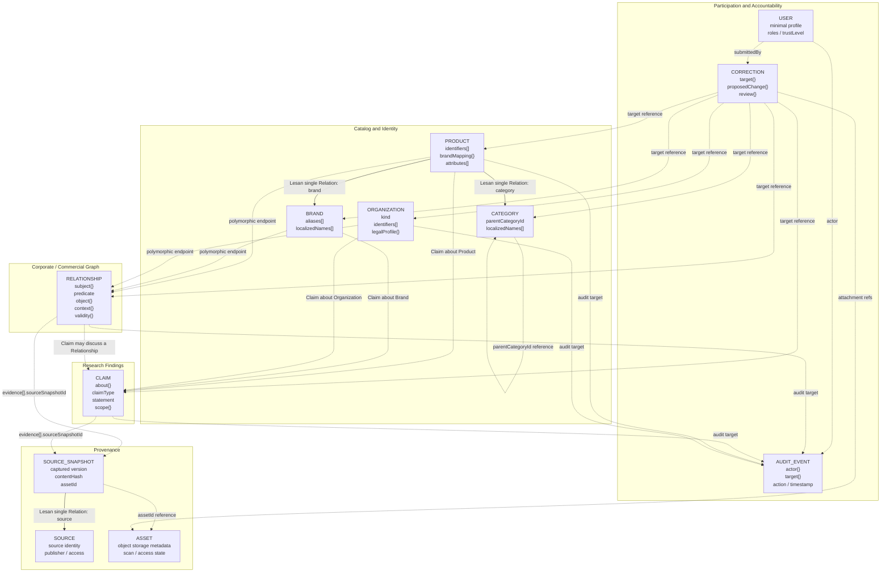

# Consumer Transparency Platform
# Final Domain ERD & MongoDB Document Model

**Document ID:** CT-DOMAIN-ERD  
**Version:** 2.0  
**Status:** Proposed canonical domain baseline for the initial implementation; validate through the Architecture Spike before production lock-in.  
**Audience:** Product owner, domain researchers, data researchers, backend/frontend developers, and AI coding agents.  
**Primary language of schema identifiers:** English. User-facing content must support Persian and be designed for multilingual extension.

---

## 0. How to Read This Document

This is the project's **domain ERD and document-model specification**. It explains what the system represents, why each entity exists, how the entities relate, and which information belongs in a MongoDB document versus an independent collection.

It is intentionally not a Lesan tutorial and does not prescribe implementation details that belong to the framework maintainer or the backend implementation guide. The data model is framework-independent at the domain level. Lesan-specific relation boundaries are identified in Section 10 so the implementation can map the domain model onto Lesan correctly.

### Status of decisions

- **Core baseline:** the proposed initial model and domain rules to use for the Architecture Spike.
- **Provisional:** a design choice that must be tested with representative data and real query patterns.
- **Future scope:** a clearly anticipated domain area that must not be mixed into the initial core until its own model is approved.

Do not interpret this document as proof that the database has already been implemented or benchmarked.

---

# 1. Product Purpose: What Are We Building?

The Consumer Transparency Platform helps people understand products and the organizations, brands, business relationships, evidence, and public information associated with those products. It also gives researchers a controlled environment to collect, verify, correct, and publish information.

It is **not merely a barcode scanner**, **not merely a boycott list**, and **not a binary “buy / do not buy” database**.

The platform has two connected audiences:

1. **Consumers**, who search for or scan a product and need clear, sourced, time-aware information.
2. **Researchers and administrators**, who identify entities, investigate relationships, manage evidence, resolve conflicting information, process corrections, review organizational responses, and decide what may be published.

The public experience may support ethical-shopping, consumer-awareness, product-alternative, and campaign-related use cases. However, the data model must not assume that every relationship is a legal violation, that every research finding is a campaign target, or that every product should receive a single political or ethical score.

## 1.1 The product must answer these questions

When a user scans a product, the system should progressively answer:

1. **What is this item?** Which exact trade item or packaging variant was scanned?
2. **Which brand is associated with it?** Is that mapping verified, provisional, or disputed?
3. **Which organizations are connected to the brand or item?** Are they brand owners, parent companies, legal entities, manufacturers, distributors, importers, or other actors?
4. **What is the exact nature of each relationship?** Who is connected to whom, in which direction, market, jurisdiction, and time period?
5. **What supports the information?** Which sources, captured versions, excerpts, pages, and evidence links support or contradict it?
6. **What is the research state?** Has it been reviewed? What did the evidence assessment conclude? Is the record public?
7. **What does the organization say?** Has it submitted a response, and has the response itself been reviewed for attribution and publication?
8. **What is not known?** Which facts are missing, outdated, disputed, or not sufficiently evidenced?
9. **What is the applicable legal position?** This must be represented separately from research findings and campaign information.
10. **What can the consumer do next?** Find a relevant alternative, report a correction, or inspect the sources and history.

The system should expose uncertainty and evidence gaps rather than manufacture certainty.

## 1.2 The core conceptual questions

| Question | Domain concept | Main data model |
|---|---|---|
| What is it? | Product, brand, organization, category | `Product`, `Brand`, `Organization`, `Category` |
| How is it connected? | Typed, directional, time-aware relationship | `Relationship` |
| What is being asserted beyond a simple edge? | Research proposition | `Claim` |
| How do we know? | Source identity, captured source version, contextual evidence | `Source`, `SourceSnapshot`, embedded `EvidenceLink` |
| Who submitted or corrected information? | Contribution and moderation | `Correction`, `User` |
| Who changed or published what? | Accountability and history | `AuditEvent` plus embedded workflow state |

---

# 2. Non-Negotiable Domain Principles

These rules define the meaning of the data. They are more important than any particular API or database syntax.

1. **Product is not Brand.** A trade item is not the same thing as the market-facing brand printed on it.
2. **Brand is not Organization.** A brand can be owned, licensed, operated, or distributed by one or more organizations over time.
3. **Corporate group is not necessarily a registered legal entity.** A group and each legal entity are distinct real-world identities, even if stored in one `organizations` collection using different `kind` values.
4. **Importer is normally a role, not a type of identity.** An Organization can import a Product into a specific market during a specific period.
5. **A barcode is an identifier, not a verdict.** A GTIN does not establish ownership, origin, political affiliation, legal status, or ethical status.
6. **Identifiers from different systems are not interchangeable.** GTIN, Iranian Product ID (`شناسه کالا`), tracking ID (`شناسه رهگیری`), legal-entity National ID, tax product/service code, HS code, IRC, TTAC UID, and other sector identifiers have different meanings and issuing authorities.
7. **Relationship is an independent graph edge.** It is directional, typed, scoped, time-aware, evidence-supported, and independently reviewable.
8. **Relationship is not Claim.** A Relationship is a structured edge between two entities. A Claim is a proposition that may concern one entity, several entities, or a Relationship.
9. **Source is not SourceSnapshot.** A Source is the identity of a source; a Snapshot is a preserved capture/version of its content.
10. **Evidence is contextual.** The same source passage may support one Claim and contradict another. Its stance belongs to the link between the evidence and its parent Claim/Relationship.
11. **Unknown is not false.** `UNKNOWN`, `NOT_FOUND`, `NOT_VERIFIED`, `INSUFFICIENT_EVIDENCE`, and `DISPUTED` must not be collapsed into a negative factual conclusion.
12. **Review workflow is not an assessment outcome.** “In review” describes work being performed; “supported” or “inconclusive” describes what the available evidence supports.
13. **Assessment is not publication.** A finding can be assessed but withheld from public release. Publication is a separate decision.
14. **Research assessment is not legal assessment.** A verified corporate relationship does not automatically mean that a legal prohibition applies.
15. **Legal status is not campaign status.** Legal applicability, research findings, and campaign targeting must be separate domains.
16. **User submission is not truth.** User-supplied corrections and observations require validation and review before being treated as accepted data.
17. **An organization's response is its attributed position.** It must not automatically overwrite the research finding.
18. **No opaque universal score in the initial platform.** Avoid a single 0–100 or red/green score that hides the evidence, criteria, jurisdiction, and date behind it.
19. **Preserve provenance and time.** Store when a source was published, when it was captured, when a relationship was valid, and when the platform recorded or changed it.
20. **Use human review for sensitive publication.** AI may assist research, extraction, translation, matching, and summarization, but must not autonomously publish sensitive factual findings.
21. **Minimize personal data.** Consumer scan history and behavioral profiles should remain local by default unless a clear, justified product requirement says otherwise.
22. **Preserve history.** Prefer audited correction, retraction, archival, and versioning over silent destructive edits.

---

# 3. Domain Vocabulary and Identity Boundaries

## 3.1 Product

A `Product` represents a specific sellable trade item or packaging configuration. For example, a 200 g jar and a 500 g jar may be separate Products if they have different GTINs or materially different trade-item identities.

A Product is not a generic product family, a brand, a company, or a barcode string alone.

## 3.2 Brand

A `Brand` is a market-facing identity under which products are presented. A brand may have several products and may be owned, operated, distributed, licensed, or otherwise connected to organizations through Relationships.

Do not store one permanent `ownerId` on Brand as the source of truth. Ownership can change and must be modeled through time-aware Relationship records.

## 3.3 Organization

An `Organization` is an institutional or commercial actor. One collection stores different organization kinds while each real-world organization remains a separate document.

Initial kinds:

- `CORPORATE_GROUP`
- `LEGAL_ENTITY`
- `GOVERNMENT_BODY`
- `PUBLIC_INSTITUTION`
- `NON_PROFIT`
- `RETAILER`
- `OTHER`

A corporate group and its subsidiary legal entities are not merged into one document. Their connections are Relationship records.

A company can be an importer in one market, a manufacturer in another relationship, and a distributor in a third. These are roles expressed by Relationships, not separate Organization kinds.

## 3.4 Category

A `Category` is a controlled product taxonomy node. It supports product discovery, filtering, category-specific attributes, and future alternative-product logic. The taxonomy must be curated and versionable; it must not become an uncontrolled user-entered text field.

## 3.5 Relationship

A `Relationship` is a directed edge:

`subject -- predicate --> object`

Examples:

- Organization A `OWNS` Brand B.
- Organization C `CONTROLS` Organization D.
- Organization E `IMPORTS_TO_MARKET` Product F in Iran.
- Organization G `MANUFACTURES` Product H.

A Relationship has a predicate, endpoint types, context, validity interval, review workflow, evidence assessment, publication state, and optional organizational responses.

## 3.6 Claim

A `Claim` is a structured research proposition that cannot or should not be represented only as a Relationship edge.

Examples:

- A Product was available in a particular market during a stated period.
- A package declares a country of origin that differs from another documented record.
- An Organization issued a specific public statement on a particular date.
- A facility operated in a particular location during a defined period.

If a proposition is exactly a structured edge such as `Organization A OWNS Brand B`, create a Relationship rather than a duplicate Claim. A separate Claim may refer to that Relationship when it asserts something additional, disputed, interpretive, or broader.

## 3.7 Source, Snapshot, EvidenceLink

- `Source`: the identity of the origin of information (official registry, legal document, annual report, company website, research report, news article, academic work, etc.).
- `SourceSnapshot`: a particular preserved capture/version of the Source at a given time.
- `EvidenceLink`: a contextual reference from a Claim or Relationship to a SourceSnapshot, with a locator, excerpt, stance, and explanation.

A cryptographic hash proves that bytes match a captured artifact; it does not prove that the artifact's content is true.

---

# 4. Final Initial ERD: Collection Topology

The initial domain model contains **12 core collections**. This count is not a goal in itself. Collections exist where identity, independent lifecycle, independent query/search, access rules, or growth patterns justify them. Related bounded data is embedded in the document that owns it.

## 4.1 Core collections

1. `products`
2. `brands`
3. `categories`
4. `organizations`
5. `relationships`
6. `claims`
7. `sources`
8. `source_snapshots`
9. `assets`
10. `corrections`
11. `users`
12. `audit_events`

If the current repository already has a working equivalent (for example, a file/asset collection or category model), inspect and reuse it rather than creating a duplicate.

## 4.2 High-level ERD (collections and references)



**Diagram note:** Solid arrows are the initial fixed-schema Lesan Relations. Dashed arrows are ordinary references or polymorphic references validated by domain services. The lines into `AUDIT_EVENT` express traceability, not an embedded event list on each entity.

## 4.3 Document-ownership map

```text
PRODUCT document
  ├── identifiers[]
  ├── localizedNames[]
  ├── attributes[]
  ├── brandMapping{}
  ├── brand                  (Lesan single Relation snapshot; optional)
  └── category               (Lesan single Relation snapshot; optional)

BRAND document
  ├── aliases[]
  └── localizedNames[]
  └── productsPreview[]      (Lesan reverse snapshot; bounded preview only)

CATEGORY document
  ├── localizedNames[]
  ├── parentCategoryId       (ordinary self-reference)
  ├── ancestorIds[]          (materialized taxonomy path)
  └── productsPreview[]      (Lesan reverse snapshot; bounded preview only)

ORGANIZATION document
  ├── aliases[]
  ├── localizedNames[]
  ├── identifiers[]
  └── legalProfile{}

RELATIONSHIP document
  ├── subject{} / predicate / object{}
  ├── context{} / validity{}
  ├── review{}
  ├── assessment{}
  ├── publication{}
  ├── evidence[]
  ├── organizationResponses[]
  ├── researchNotes[]
  └── recentRevisionPreview[]

CLAIM document
  ├── about{} / relatedEntities[]
  ├── claimType / statement / structuredValue{}
  ├── scope{}
  ├── review{}
  ├── assessment{}
  ├── publication{}
  ├── evidence[]
  ├── organizationResponses[]
  └── researchNotes[]

SOURCE document
  └── recentSnapshotsPreview[] (Lesan reverse snapshot; bounded preview only)

SOURCE_SNAPSHOT document
  ├── source                (Lesan single Relation snapshot)
  └── assetId               (ordinary reference to ASSET)

CORRECTION document
  ├── target{}              (polymorphic reference; optional for ADD_MISSING)
  ├── proposedChange{}
  ├── evidenceReferences[]
  └── review{}

ASSET document
  └── storage and processing metadata; binary bytes live in object storage

USER document
  └── minimal account / role / contribution metadata

AUDIT_EVENT document
  └── immutable append-only event; no embedded unbounded history on parent documents
```

---

# 5. Relationship and Cardinality Matrix

| From | To | Cardinality | Meaning and storage |
|---|---|---:|---|
| Product | Brand | Product `0..1` primary Brand; Brand `0..N` Products | Lesan single Relation from Product to Brand; Brand reverse preview is bounded and not complete. |
| Product | Category | Product `0..1` primary Category; Category `0..N` Products | Lesan single Relation from Product to Category; Category reverse preview is bounded. Additional taxonomy memberships require a separate decision. |
| Category | Parent Category | Category `0..1` parent; parent `0..N` children | Ordinary `parentCategoryId` reference plus `ancestorIds[]`; do not assume a self-relation is needed. |
| Organization | Organization / Brand / Product | `0..N` through Relationships | Relationship graph; never embed an unbounded full edge list in Organization. |
| Brand | Organization / Product | `0..N` through Relationships and Product relation | Brand ownership/control/operation is a Relationship; Products use their primary Brand Relation. |
| Relationship | Subject endpoint | Exactly `1` | Polymorphic `{type,id}` reference to Product, Brand, or Organization. |
| Relationship | Object endpoint | Exactly `1` | Polymorphic `{type,id}` reference to Product, Brand, or Organization. |
| Claim | Primary subject (`about`) | Exactly `1` | Polymorphic reference to Product, Brand, Organization, or Relationship. |
| Claim | Related entities | `0..10` initially | Bounded contextual references; not a substitute for Relationship edges. |
| Claim / Relationship | EvidenceLinks | `0..N` within approved budget | Embedded, because stance and excerpt belong to the parent finding. Split only if growth or independent use justifies it. |
| Claim / Relationship | Organization responses | `0..N` within approved budget | Embedded in the finding they address. |
| Source | SourceSnapshot | `1 : 0..N` | One Source has many immutable captures; Lesan reverse snapshot is a bounded preview only. |
| SourceSnapshot | Source | Exactly `1` | Lesan single Relation. |
| SourceSnapshot | Asset | `0..1` | Ordinary reference to the preserved file/content artifact. |
| User | Correction | `1 : 0..N` | `submittedBy` reference; each Correction has one submitter or a controlled SYSTEM actor. |
| Correction | Target | `0..1` | Polymorphic reference; absent only for a valid `ADD_MISSING` submission. |
| Correction | Evidence references | `0..10` initially | Embedded references to SourceSnapshots, Assets, or URLs; no arbitrary database patch. |
| User / System / Service | AuditEvent | `1 : 0..N` | Audit records are independent append-only documents. |

Cardinality is domain semantics. It does not mean every reverse array is complete. Lesan reverse arrays configured with a `limit` are previews only.

---

# 6. Shared Types and Time Semantics

## 6.1 Polymorphic reference

Use typed references for endpoints that may point to several collection types:

```ts
type EntityType = "PRODUCT" | "BRAND" | "ORGANIZATION" | "RELATIONSHIP";

type EntityRef<T extends EntityType = EntityType> = {
  type: T;
  id: ObjectId;
};
```

Use narrower type unions for specific fields:

```ts
type RelationshipEndpointType = "PRODUCT" | "BRAND" | "ORGANIZATION";
type ClaimAboutType = "PRODUCT" | "BRAND" | "ORGANIZATION" | "RELATIONSHIP";
type CorrectionTargetType =
  | "PRODUCT" | "BRAND" | "CATEGORY" | "ORGANIZATION"
  | "RELATIONSHIP" | "CLAIM" | "SOURCE" | "SOURCE_SNAPSHOT";
```

These are application-level references, not MongoDB foreign keys. Resolve them only through a server-controlled registry. Never accept an arbitrary collection name, model name, MongoDB path, or operator from a client.

## 6.2 Valid time and recorded time are different

For a Relationship or time-scoped Claim, keep two separate notions:

- **Valid time:** when the statement was true in the real world.
- **Recorded time:** when the platform learned, captured, or stored the statement.

Example:

```ts
validity: {
  validFrom: Date | null,
  validTo: Date | null
},
recordedAt: Date,
createdAt: Date,
updatedAt: Date
```

Use a half-open interval `[validFrom, validTo)` when applicable. Unknown dates remain null; do not invent exact dates from vague source wording. `validTo: null` means no end date is recorded. It does **not** by itself prove the relationship is still current today.

## 6.3 Common document metadata

Mutable canonical documents normally include:

```ts
{
  _id: ObjectId,
  schemaVersion: number,
  version: number,
  createdAt: Date,
  updatedAt: Date,
  createdBy?: ObjectId,
  updatedBy?: ObjectId
}
```

- `schemaVersion` tracks persisted document shape.
- `version` tracks accepted mutations for optimistic concurrency.
- `createdBy` and `updatedBy` are convenience fields, not a substitute for Audit Events.
- Audit Events are append-only and do not need a mutable `updatedAt`.
- Store dates in UTC BSON Date; localize display in the UI.
- Every important canonical identity field should have traceable provenance where available. `identityProvenance` is a small summary; detailed source captures remain in `source_snapshots`.

---

# 7. Collection Definitions

## 7.1 `products`

### Responsibility

Represents an exact trade item / packaging configuration that a consumer may search for or scan.

### Proposed document shape

```ts
type ProductIdentifier = {
  _id: ObjectId;
  scheme:
    | "GTIN"
    | "IR_PRODUCT_ID"              // Iranian Product ID / شناسه کالا
    | "IR_TRACKING_ID"             // شناسه رهگیری
    | "TAX_PRODUCT_SERVICE_ID"      // شناسه کالا/خدمت مالیاتی
    | "HS_CODE"
    | "IRC"
    | "TTAC_UID"
    | "SKU"
    | "OTHER";
  value: string;                    // always string; preserve leading zeroes
  normalizedValue: string;
  jurisdiction?: string;            // ISO country code or defined jurisdiction code
  issuer?: string;
  status: "UNVERIFIED" | "VERIFIED" | "DISPUTED" | "RETIRED";
  sourceSnapshotIds?: ObjectId[];
  validFrom?: Date | null;
  validTo?: Date | null;
};

type ProductDocument = {
  _id: ObjectId;
  schemaVersion: number;
  version: number;

  name: string;
  normalizedName: string;
  localizedNames?: Array<{ locale: string; value: string }>;
  description?: string;

  identifiers: ProductIdentifier[];

  // Lesan-managed, optional single Relation snapshots:
  brand?: BrandRelationSnapshot;
  category?: CategoryRelationSnapshot;

  identityProvenance?: {
    sourceSnapshotIds?: ObjectId[];
    lastVerifiedAt?: Date;
    verifiedBy?: ObjectId;
  };

  brandMapping: {
    status: "UNREVIEWED" | "CANDIDATE" | "VERIFIED" | "DISPUTED" | "REJECTED";
    candidateBrandId?: ObjectId;
    rationale?: string;
    reviewedAt?: Date;
    reviewedBy?: ObjectId;
    evidenceSnapshotIds?: ObjectId[];
  };

  packaging?: {
    netContentValue?: number;
    netContentUnit?: string;
    packCount?: number;
    packageType?: string;
    variant?: string;
    modelOrSize?: string;
  };

  attributes?: Array<{
    key: string;
    value: string | number | boolean;
    unit?: string;
    locale?: string;
    sourceSnapshotId?: ObjectId;
  }>;

  lifecycle: "ACTIVE" | "INACTIVE" | "ARCHIVED" | "MERGED";
  mergedIntoProductId?: ObjectId;

  createdAt: Date;
  updatedAt: Date;
  createdBy?: ObjectId;
  updatedBy?: ObjectId;
};
```

### Domain rules

- A GTIN is stored as a string and validated by length/check digit for GTIN-8/12/13/14 where applicable.
- An identifier must be interpreted with its `scheme`, issuer, jurisdiction, and time context. Never compare values from different schemes as if they were the same identifier.
- A GS1 prefix or barcode allocation must not be used to infer manufacturing country, company nationality, ownership, or ethical/legal status.
- A Product may temporarily have no verified Brand or Category mapping.
- `brandMapping.candidateBrandId` is a provisional application reference. It is not the accepted Brand Relation.
- Only an approved mapping populates `brand` as the accepted Lesan Relation. Disputed mappings must not be presented as confirmed.
- The initial model supports one primary Brand and one primary Category. Co-branded or multi-category trade items require an explicit extension rather than silently overloading these fields.
- Product attributes must use a controlled, category-aware registry. Do not allow arbitrary nested client JSON.
- Product identifiers are embedded because their expected count per trade item is small and they are read with the Product. If identifiers become independently moderated, many-to-many, or high-volume, propose a separate `product_identifiers` collection.

## 7.2 `brands`

### Responsibility

Represents a market-facing Brand identity. Ownership, operation, control, distribution, and licensing are not stored as mutable Brand fields; they are Relationships.

### Proposed document shape

```ts
type BrandDocument = {
  _id: ObjectId;
  schemaVersion: number;
  version: number;

  name: string;
  normalizedName: string;
  localizedNames?: Array<{ locale: string; value: string }>;
  aliases: Array<{
    _id: ObjectId;
    value: string;
    normalizedValue: string;
    locale?: string;
    sourceSnapshotId?: ObjectId;
  }>;

  description?: string;
  website?: string;
  logoAssetId?: ObjectId;
  identityProvenance?: {
    sourceSnapshotIds?: ObjectId[];
    lastVerifiedAt?: Date;
    verifiedBy?: ObjectId;
  };

  lifecycle: "ACTIVE" | "INACTIVE" | "ARCHIVED" | "MERGED";
  mergedIntoBrandId?: ObjectId;

  createdAt: Date;
  updatedAt: Date;
  createdBy?: ObjectId;
  updatedBy?: ObjectId;
  // productsPreview[] is a bounded Lesan reverse snapshot, not a canonical full list.
};
```

### Domain rules

- Do not store a single permanent owner field.
- Aliases and localized names help entity resolution; they do not prove that two names identify the same Brand.
- `productsPreview[]` is only a convenience preview. Query `products` for the full paginated Product list and counts.
- Do not place large images or base64 data in the Brand document; use `assets`/object storage.

## 7.3 `categories`

### Responsibility

Provides a curated taxonomy used for navigation, search, filtering, and category-aware Product attributes.

### Proposed document shape

```ts
type CategoryDocument = {
  _id: ObjectId;
  schemaVersion: number;
  version: number;

  code: string;                     // stable internal taxonomy code
  name: string;
  normalizedName: string;
  localizedNames: Array<{ locale: string; value: string }>;

  parentCategoryId?: ObjectId | null;
  ancestorIds: ObjectId[];          // materialized path for tree queries
  depth: number;
  sortOrder?: number;
  description?: string;

  lifecycle: "ACTIVE" | "INACTIVE" | "ARCHIVED";
  taxonomyVersion: number;

  createdAt: Date;
  updatedAt: Date;
};
```

### Domain rules

- Category codes are stable even when translated labels change.
- `parentCategoryId` is an ordinary reference. `ancestorIds[]` is a denormalized path maintained by a domain service; test subtree moves and prevent cycles.
- Product points to one primary Category using the initial Lesan Relation. `productsPreview[]` is a bounded reverse snapshot only.
- Do not infer legal or campaign status from category membership.

## 7.4 `organizations`

### Responsibility

Stores the identity of corporate groups, legal entities, public bodies, non-profits, retailers, and other organizations.

### Proposed document shape

```ts
type OrganizationIdentifier = {
  _id: ObjectId;
  scheme: "NATIONAL_ID" | "REGISTRATION_NUMBER" | "LEI" | "TAX_ID" | "OTHER";
  value: string;
  normalizedValue: string;
  jurisdiction?: string;
  issuer?: string;
  status: "UNVERIFIED" | "VERIFIED" | "DISPUTED" | "RETIRED";
  sourceSnapshotIds?: ObjectId[];
};

type OrganizationDocument = {
  _id: ObjectId;
  schemaVersion: number;
  version: number;

  name: string;
  normalizedName: string;
  localizedNames?: Array<{ locale: string; value: string }>;
  kind:
    | "CORPORATE_GROUP"
    | "LEGAL_ENTITY"
    | "GOVERNMENT_BODY"
    | "PUBLIC_INSTITUTION"
    | "NON_PROFIT"
    | "RETAILER"
    | "OTHER";

  aliases: Array<{
    _id: ObjectId;
    value: string;
    normalizedValue: string;
    locale?: string;
    sourceSnapshotId?: ObjectId;
  }>;

  identifiers: OrganizationIdentifier[];

  legalProfile?: {
    jurisdiction?: string;
    legalForm?: string;
    incorporationDate?: Date;
    registeredAddress?: string;     // access-controlled where personal/sensitive
  };

  website?: string;
  operatingCountryCodes?: string[];
  identityProvenance?: {
    sourceSnapshotIds?: ObjectId[];
    lastVerifiedAt?: Date;
    verifiedBy?: ObjectId;
  };
  description?: string;

  lifecycle: "ACTIVE" | "INACTIVE" | "DISSOLVED" | "ARCHIVED" | "MERGED";
  mergedIntoOrganizationId?: ObjectId;

  createdAt: Date;
  updatedAt: Date;
  createdBy?: ObjectId;
  updatedBy?: ObjectId;
};
```

### Domain rules

- Corporate group and subsidiary/legal entity remain separate Organization documents.
- Their ownership/control links are Relationship documents.
- `Importer`, `Manufacturer`, `Distributor`, `Supplier`, and `Retailer` are not separate identity collections in the initial model. These are Organization kinds or Relationship roles, depending on the meaning.
- Organization names are not unique identifiers.
- National IDs and registration numbers must be scoped by scheme and jurisdiction.
- Do not infer ownership/control from name similarity, a shared address, a shared director, or a single unverified source.
- Do not treat a brand's country-of-origin field, an organization's registration jurisdiction, and a product's manufacturing origin as interchangeable facts.

## 7.5 `relationships`

### Responsibility

Represents a directed, typed edge between two Product, Brand, or Organization documents. This is the central graph collection.

### Endpoint contract

```ts
type RelationshipEndpointType = "PRODUCT" | "BRAND" | "ORGANIZATION";
type RelationshipEndpoint = {
  type: RelationshipEndpointType;
  id: ObjectId;
};
```

### Initial predicate registry

```ts
type RelationshipPredicate =
  | "OWNS"
  | "CONTROLS"
  | "SUBSIDIARY_OF"
  | "MANUFACTURES"
  | "DISTRIBUTES"
  | "IMPORTS_TO_MARKET"
  | "EXPORTS_TO_MARKET"
  | "SUPPLIES"
  | "OPERATES";
```

Predicate meaning and direction must be defined centrally. Do not accept arbitrary predicate strings or a generic `OTHER` in canonical published Relationships.

| Predicate | Subject type | Object type | Direction / required interpretation |
|---|---|---|---|
| `OWNS` | Organization | Organization or Brand | Subject owns object. If share/percentage is known, preserve the documented basis and date. Ownership does not automatically equal operational control. |
| `CONTROLS` | Organization | Organization or Brand | Subject exercises documented control over object. The control basis must be explicit; do not infer it from a small shareholding or name similarity. |
| `SUBSIDIARY_OF` | Organization | Organization | Subject is the subsidiary; object is its parent. Avoid duplicate edges that merely restate the same fact without added meaning. |
| `MANUFACTURES` | Organization | Product | Subject manufactures object. Distinguish manufacturer from brand owner and importer. |
| `DISTRIBUTES` | Organization | Product or Brand | Subject distributes object; market context is normally required where distribution is market-specific. |
| `IMPORTS_TO_MARKET` | Organization | Product | Subject imports Product into `context.marketCountryCode`; country and validity period must not be guessed. |
| `EXPORTS_TO_MARKET` | Organization | Product | Subject exports Product to the destination in `context.marketCountryCode`; this does not follow from brand nationality. |
| `SUPPLIES` | Organization | Organization or Product | Subject supplies object. Define the supply role and market/time scope where known. |
| `OPERATES` | Organization | Brand or Product | Subject operates the Brand/Product. The precise operation type must be recorded in context. |

`LICENSES` and `FRANCHISES` are excluded from the initial registry until the parties, direction, licensed asset, validity, and evidence requirements are precisely defined.

### Proposed document shape

```ts
type RelationshipDocument = {
  _id: ObjectId;
  schemaVersion: number;
  version: number;

  subject: RelationshipEndpoint;
  predicate: RelationshipPredicate;
  predicateRegistryVersion: number;
  object: RelationshipEndpoint;

  context?: {
    marketCountryCode?: string;
    jurisdiction?: string;
    businessUnit?: string;
    operationRole?: string;
    ownership?: {
      sharePercentage?: number;
      basis?: "DIRECT" | "INDIRECT" | "VOTING_RIGHTS" | "OTHER_DOCUMENTED";
      notes?: string;
    };
    notes?: string;
  };

  validity: {
    validFrom?: Date | null;
    validTo?: Date | null;
    datePrecision?: "EXACT" | "MONTH" | "YEAR" | "APPROXIMATE" | "UNKNOWN";
  };

  recordLifecycle: "ACTIVE" | "ARCHIVED";

  review: ReviewWorkflow;
  assessment: EvidenceAssessment;
  publication: PublicationState;

  evidence: EvidenceLink[];
  organizationResponses: OrganizationResponse[];
  researchNotes: ResearchNote[];
  recentRevisionPreview: RevisionPreview[];

  canonicalKey?: string;             // helper for duplicate detection; not automatically unique
  recordedAt: Date;
  createdAt: Date;
  updatedAt: Date;
  createdBy?: ObjectId;
  updatedBy?: ObjectId;
};
```

### Critical historical rule

If Organization A owned Brand B from 2019 to 2023 and Organization C owned Brand B from 2023 onward, create two different Relationship documents:

```text
A -- OWNS --> Brand B   [2019-01-01, 2023-01-01)
C -- OWNS --> Brand B   [2023-01-01, open end]
```

Do **not** rewrite the old Relationship's subject from A to C. The new owner is a new edge. A correction to the dates, evidence, or interpretation of the same edge increments its version and creates an Audit Event.

### Duplicate and inference rules

- A candidate `canonicalKey` can be composed from subject type/id, predicate, object type/id, and normalized context scope.
- Do not apply a unique index until the team defines whether overlapping edges with the same endpoints/predicate but different market, legal scope, sources, or validity intervals are legitimate.
- A chain of relationships must not automatically become a published ultimate-ownership/control conclusion. Any derived graph inference requires a documented method, dates, confidence/limitations, and human review.
- Do not store both directions of the same fact unless they represent genuinely different predicates or an explicitly approved read model.
- `recordLifecycle`, real-world `validity`, research `assessment`, and `publication` answer different questions. Do not collapse them into one status.

## 7.6 `claims`

### Responsibility

Stores research propositions that are not adequately represented by a typed Relationship edge.

### Proposed document shape

```ts
type ClaimAboutType = "PRODUCT" | "BRAND" | "ORGANIZATION" | "RELATIONSHIP";

type ClaimDocument = {
  _id: ObjectId;
  schemaVersion: number;
  version: number;

  about: { type: ClaimAboutType; id: ObjectId };
  relatedEntities?: RelationshipEndpoint[]; // bounded, contextual only

  claimType:
    | "MARKET_PRESENCE"
    | "PRODUCT_ORIGIN"
    | "MANUFACTURING_LOCATION"
    | "CORPORATE_ACTIVITY"
    | "OFFICIAL_STATEMENT"
    | "PRODUCT_ATTRIBUTE"
    | "OTHER_REVIEWED_TYPE";

  statement: string;
  localizedStatements?: Array<{ locale: string; value: string }>;
  structuredValue?: Record<string, unknown>; // strictly validated by claimType registry

  scope?: {
    marketCountryCode?: string;
    jurisdiction?: string;
    validFrom?: Date | null;
    validTo?: Date | null;
  };

  recordLifecycle: "ACTIVE" | "ARCHIVED";
  review: ReviewWorkflow;
  assessment: EvidenceAssessment;
  publication: PublicationState;

  evidence: EvidenceLink[];
  organizationResponses: OrganizationResponse[];
  researchNotes: ResearchNote[];

  recordedAt: Date;
  createdAt: Date;
  updatedAt: Date;
  createdBy?: ObjectId;
  updatedBy?: ObjectId;
};
```

### Domain rules

- `about` is exactly one primary subject. `relatedEntities` is a small contextual list, not an alternative graph.
- A Claim may be about a Relationship when discussing an interpretation, consequence, dispute, or broader proposition concerning that edge.
- Avoid a duplicate Claim that simply repeats the same structured Relationship. If the Claim carries a separate proposition, explain the distinction in its type and statement.
- `structuredValue` must be a discriminated, allowlisted structure for each `claimType`; do not accept arbitrary JSON.
- A Claim can be assessed as supported, partially supported, not supported, disputed, or inconclusive. The review workflow status is independent.

## 7.7 `sources`

### Responsibility

Represents the identity of an information source, not a particular captured version of its content.

### Proposed document shape

```ts
type SourceDocument = {
  _id: ObjectId;
  schemaVersion: number;
  version: number;

  title: string;
  canonicalUrl?: string;
  sourceType:
    | "OFFICIAL_REGISTRY"
    | "GOVERNMENT_DOCUMENT"
    | "LEGAL_INSTRUMENT"
    | "COMPANY_DOCUMENT"
    | "RESEARCH_REPORT"
    | "NEWS"
    | "ACADEMIC"
    | "DATASET"
    | "OTHER";

  publisherName?: string;
  publisherOrganizationId?: ObjectId;
  language?: string;
  countryCode?: string;
  jurisdiction?: string;
  description?: string;

  access: "PUBLIC" | "RESTRICTED" | "INTERNAL";
  usageTerms?: string;
  lifecycle: "ACTIVE" | "UNAVAILABLE" | "ARCHIVED";
  lastCapturedAt?: Date;

  createdAt: Date;
  updatedAt: Date;
  createdBy?: ObjectId;
  // recentSnapshotsPreview[] is a bounded Lesan reverse snapshot.
};
```

### Domain rules

- Source type, publisher, hosting domain, jurisdiction, and access rights are separate properties.
- `acquisitionTier` on a Snapshot describes how the platform obtained that capture (official machine-readable, official public lookup, authenticated official access, formal information request, or research/community source). It is a data-access classification, not a reliability score.
- Do not assign an opaque universal “reliability score” in the MVP. Record what the source is, why it is relevant, its limitations, and the reviewer's reasoning.
- An official-looking domain is not automatically proof that the publisher is an official authority. Publisher identity must be verified.
- If the system fetches user-provided URLs, treat the fetcher as an SSRF-sensitive service. Enforce HTTPS by default, block local/private/link-local/reserved addresses and cloud metadata endpoints, revalidate redirects and DNS, cap redirects/time/body size, and never send ambient credentials.

## 7.8 `source_snapshots`

### Responsibility

Preserves a specific capture of a Source at a point in time. A changed source creates a new Snapshot; old snapshots are not silently overwritten.

### Proposed document shape

```ts
type SourceSnapshotDocument = {
  _id: ObjectId;
  schemaVersion: number;
  version: number;

  source: SourceRelationSnapshot;     // Lesan single Relation to Source
  titleAtCapture?: string;
  canonicalUrlAtCapture?: string;
  publishedAt?: Date;
  retrievedAt: Date;

  contentHash: string;
  hashAlgorithm: "SHA256";
  mimeType?: string;
  byteSize?: number;
  assetId?: ObjectId;                 // Asset holding original captured bytes

  captureMethod: "MANUAL" | "CRAWLER" | "API" | "UPLOAD";
  acquisitionTier?: "A_OFFICIAL_MACHINE_READABLE" | "B_OFFICIAL_PUBLIC_LOOKUP" | "C_OFFICIAL_AUTHENTICATED_ACCESS" | "D_FORMAL_INFORMATION_REQUEST" | "E_RESEARCH_OR_COMMUNITY";
  capturedBy?: ObjectId;
  captureMetadata?: Record<string, unknown>; // bounded, allowlisted technical metadata

  lifecycle: "AVAILABLE" | "UNAVAILABLE" | "REDACTED" | "ARCHIVED";
  createdAt: Date;
};
```

### Domain rules

- SourceSnapshots are immutable in content identity. Correcting metadata may create a new document or an audited metadata revision; never replace the original captured bytes without trace.
- `contentHash` is calculated from the captured bytes using the stated algorithm.
- Keep complete capture bytes in `assets`/object storage, not as base64 in the Snapshot document.
- Preserve capture time and original URL. `publishedAt` may be unknown and must not be guessed from capture time.
- A restricted/internal Snapshot must not become public merely because a Claim referring to it is published.

## 7.9 `assets`

### Responsibility

Stores metadata and lifecycle for uploaded or captured files. Binary objects live in object storage; MongoDB stores references and security/processing metadata.

### Proposed document shape

```ts
type AssetDocument = {
  _id: ObjectId;
  schemaVersion: number;
  version: number;

  storage: {
    provider: "S3_COMPATIBLE" | "LOCAL_DEV" | "OTHER";
    bucket?: string;
    objectKey: string;
  };

  originalFileName?: string;
  safeDisplayName?: string;
  mimeType: string;
  byteSize: number;
  sha256: string;

  processingStatus:
    | "QUARANTINED"
    | "SCANNING"
    | "READY"
    | "REJECTED"
    | "REDACTED";

  visibility: "PRIVATE" | "RESEARCH_ONLY" | "PUBLIC_APPROVED";
  uploadedBy?: ObjectId;
  uploadedAt: Date;

  malwareScan?: {
    engine?: string;
    result?: "CLEAN" | "INFECTED" | "ERROR";
    scannedAt?: Date;
  };

  lifecycle: "ACTIVE" | "ARCHIVED" | "DELETED_PENDING_PURGE";
};
```

### Domain rules

- Validate MIME type by inspecting bytes, not just filename or client-provided headers.
- Enforce file-size, extension, and content-type allowlists.
- Quarantine new uploads until malware scanning and validation are complete.
- Strip or review EXIF/metadata and detect/redact personal data before public exposure.
- Use short-lived authorized download URLs; do not expose private bucket/object keys directly.
- Asset references may appear in SourceSnapshot, Correction, and OrganizationResponse embedded records.
- Avoid storing duplicate file bytes for the same logical artifact unless retention or provenance rules require separate copies.

## 7.10 `corrections`

### Responsibility

Stores a submitted request to correct, complete, challenge, or retract existing platform information, or to suggest a missing entity/relationship.

Correction is an independent collection because submissions arrive separately from the target's lifecycle, need moderation/review, may exist before the target is created, and require their own queue, status, submitter, and audit history.

### Proposed document shape

```ts
type CorrectionDocument = {
  _id: ObjectId;
  schemaVersion: number;
  version: number;

  target?: {
    type: "PRODUCT" | "BRAND" | "CATEGORY" | "ORGANIZATION"
        | "RELATIONSHIP" | "CLAIM" | "SOURCE" | "SOURCE_SNAPSHOT";
    id: ObjectId;
  };                                   // absent only for valid ADD_MISSING

  submissionKind:
    | "CORRECT_EXISTING"
    | "ADD_MISSING"
    | "RETRACT"
    | "REPORT_ISSUE";

  proposedChange?: {
    fieldKey?: string;                 // allowlisted domain key, never arbitrary Mongo path
    operation: "SET" | "UNSET" | "ADD_RELATIONSHIP" | "END_RELATIONSHIP" | "OTHER_REVIEWED";
    proposedValue?: unknown;           // validated against target-specific schema
    proposedEntity?: RelationshipEndpoint;
  };

  reason: string;
  evidenceReferences: Array<{
    sourceSnapshotId?: ObjectId;
    assetId?: ObjectId;
    url?: string;
    note?: string;
  }>;

  submittedBy: ObjectId;
  submittedAt: Date;

  status:
    | "PENDING"
    | "IN_REVIEW"
    | "NEEDS_INFORMATION"
    | "APPROVED"
    | "REJECTED"
    | "WITHDRAWN";

  review: {
    assignedTo?: ObjectId;
    reviewedBy?: ObjectId;
    reviewedAt?: Date;
    decisionReason?: string;
  };

  application?: {
    appliedAt?: Date;
    appliedBy?: ObjectId;
    targetVersionBefore?: number;
    targetVersionAfter?: number;
    result?: "APPLIED" | "FAILED" | "NOT_APPLICABLE";
  };

  createdAt: Date;
  updatedAt: Date;
};
```

### Critical rules

- Never apply `proposedValue` as an arbitrary MongoDB `$set` patch.
- Validate `fieldKey` and `operation` against a strict allowlist for the target type.
- `ADD_RELATIONSHIP` and `END_RELATIONSHIP` must call dedicated domain operations.
- Approval is not the same as application. An approved correction is applied through a domain action with authorization, expected-version checks, idempotency, and an Audit Event.
- The submitter never directly edits canonical data through the Correction record.

## 7.11 `users`

### Responsibility

Represents registered consumer/contributor accounts and internal staff accounts. Store only the personal data needed for the account and workflow.

### Proposed document shape

```ts
type UserDocument = {
  _id: ObjectId;
  schemaVersion: number;
  version: number;

  authProvider?: string;
  authSubject?: string;
  email?: string;                      // private; do not expose through public projections
  phone?: string;                      // private; store only if required
  displayName?: string;
  preferredLocale?: string;

  roles: Array<
    | "CONTRIBUTOR"
    | "RESEARCHER"
    | "LEGAL_REVIEWER"
    | "MODERATOR"
    | "ADMIN"
  >;

  trustLevel: "NEW" | "REGULAR" | "TRUSTED";
  accountStatus: "PENDING" | "ACTIVE" | "SUSPENDED" | "CLOSED";

  createdAt: Date;
  updatedAt: Date;
  lastActiveAt?: Date;
};
```

### Domain rules

- A trust level is not an authorization role. A trusted contributor is not automatically a researcher, legal reviewer, moderator, or administrator.
- Guest consumers do not need a persistent account merely to search or scan.
- Scan history and consumer behavior should be local by default; do not create server-side tracking unless there is an explicit requirement and privacy review.
- Public projections must never expose authentication identifiers, email, phone, internal roles, or private profile data.

## 7.12 `audit_events`

### Responsibility

Stores append-only accountability records for material actions and changes. Do not embed an unbounded audit array in Product, Brand, Organization, Relationship, Claim, Correction, or User documents.

### Proposed document shape

```ts
type AuditEventDocument = {
  _id: ObjectId;
  eventSchemaVersion: number;

  actor: {
    type: "USER" | "SYSTEM" | "SERVICE";
    id?: ObjectId;
  };

  action: string;                       // controlled event/action registry
  target: {
    type: string;                       // controlled target registry
    id: ObjectId;
  };

  requestId?: string;
  correlationId?: string;
  targetVersionBefore?: number;
  targetVersionAfter?: number;
  changedPaths?: string[];
  beforeSummary?: Record<string, unknown>;
  afterSummary?: Record<string, unknown>;
  reason?: string;
  occurredAt: Date;
};
```

### Domain rules

- Append-only: application paths must not update or delete an Audit Event.
- Redact secrets and personal data from before/after summaries.
- For highly sensitive events, record the changed field names and a safe summary rather than a raw document copy.
- Record publication, retraction, approval, rejection, evidence changes, Relationship endpoint/validity changes, permission changes, and correction application.
- Use `requestId`/`correlationId` to connect multiple events produced by one workflow.
- Audit Events are not a substitute for complete immutable source artifacts. Use SourceSnapshots for source provenance.

---

# 8. Embedded Subdocuments: Shared Contracts

The following structures belong inside `relationships` and/or `claims`, unless a future split is approved.

## 8.1 `EvidenceLink`

```ts
type EvidenceLink = {
  _id: ObjectId;
  sourceSnapshotId: ObjectId;
  stance: "SUPPORTS" | "CONTRADICTS" | "CONTEXTUALIZES" | "NEUTRAL";

  locator?: {
    page?: number;
    section?: string;
    paragraph?: string;
    timestamp?: string;
    urlFragment?: string;
  };

  excerpt?: string;
  rationale?: string;
  addedBy?: ObjectId;
  addedAt: Date;
  reviewedBy?: ObjectId;
  reviewedAt?: Date;
};
```

Rules:

- Evidence stance is contextual to the parent finding.
- `sourceSnapshotId` must resolve to an existing Snapshot.
- Excerpts should be concise and respect copyright, licensing, and privacy restrictions.
- The full source bytes stay in controlled Asset/Object Storage, not in the parent.
- If an evidence item becomes independently reused, moderated, versioned, or globally searched as a first-class identity, consider a separate `evidence_items` collection. Do not add it merely to reproduce a SQL join table.

## 8.2 `ReviewWorkflow`

This represents the **work being performed**, not the conclusion about truth.

```ts
type ReviewWorkflow = {
  status:
    | "NOT_QUEUED"
    | "QUEUED"
    | "IN_REVIEW"
    | "NEEDS_INFORMATION"
    | "READY_FOR_DECISION"
    | "CLOSED";

  assignedTo?: ObjectId;
  priority: "LOW" | "NORMAL" | "HIGH" | "URGENT";
  openedAt?: Date;
  lastActionAt?: Date;
  closedAt?: Date;
};
```

## 8.3 `EvidenceAssessment`

This represents the **current research assessment of the evidence**. It is not the review queue status, legal status, or campaign status.

```ts
type EvidenceAssessment = {
  outcome:
    | "NOT_ASSESSED"
    | "SUPPORTED"
    | "PARTIALLY_SUPPORTED"
    | "NOT_SUPPORTED"
    | "DISPUTED"
    | "INCONCLUSIVE";

  summary?: string;
  assessedAt?: Date;
  assessedBy?: ObjectId;
  methodologyVersion?: string;
  limitations?: string[];
};
```

Definitions:

- `SUPPORTED`: the reviewed evidence supports the precisely worded proposition within its stated scope and dates.
- `PARTIALLY_SUPPORTED`: only part of the proposition or scope is supported; the public wording must be narrowed.
- `NOT_SUPPORTED`: the available reviewed evidence does not support the proposition. This does not necessarily prove its opposite.
- `DISPUTED`: credible evidence or interpretations materially conflict; the conflict must be described.
- `INCONCLUSIVE`: the available evidence is insufficient to reach a defensible conclusion.
- `NOT_ASSESSED`: no conclusion has been reached.

Do not use `NOT_SUPPORTED` as a synonym for `FALSE`, and do not use `DISPUTED` merely because a user disagrees.

## 8.4 `PublicationState`

This represents the **public visibility decision**.

```ts
type PublicationState = {
  status: "DRAFT" | "PENDING_REVIEW" | "PUBLISHED" | "WITHHELD" | "RETRACTED";
  decidedBy?: ObjectId;
  decidedAt?: Date;
  publishedAt?: Date;
  reason?: string;
  visibilityScope?: "PUBLIC" | "RESEARCH_ONLY";
};
```

Rules:

- `PUBLISHED` means the approved public representation is visible.
- `WITHHELD` means the finding is deliberately not public, even if research work exists.
- `RETRACTED` means a previously published assertion was withdrawn. Preserve the reason and audit history.
- `VERIFIED`/`SUPPORTED` does not automatically mean `PUBLISHED`.
- Publication history is captured by Audit Events; do not maintain a duplicate unbounded `history[]` array.

## 8.5 `OrganizationResponse`

```ts
type OrganizationResponse = {
  _id: ObjectId;
  respondingOrganizationId: ObjectId;
  responseText: string;
  submittedAt: Date;
  receivedVia: "OFFICIAL_EMAIL" | "OFFICIAL_FORM" | "PUBLIC_STATEMENT" | "OTHER";
  sourceSnapshotId?: ObjectId;
  attachmentAssetIds?: ObjectId[];
  representativeVerification?: {
    status: "UNVERIFIED" | "VERIFIED" | "DISPUTED";
    basis?: string;
    reviewedBy?: ObjectId;
    reviewedAt?: Date;
  };
  publicationStatus: "INTERNAL" | "PUBLIC_PENDING" | "PUBLIC" | "REDACTED";
  reviewedBy?: ObjectId;
  reviewedAt?: Date;
};
```

Rules:

- Use `organizationResponses[]`, not `companyResponses[]`, because a respondent can be any Organization kind.
- The response is embedded in the Claim/Relationship it addresses.
- The organization and the authority of the representative are separate questions.
- The response is an attributed position, not an automatic correction of the research assessment.
- Keep response count/text bounded. Split into a separate collection only if independent response workflows/search/volume justify it.

## 8.6 `ResearchNote`

```ts
type ResearchNote = {
  _id: ObjectId;
  authorId: ObjectId;
  body: string;
  visibility: "INTERNAL_RESEARCH" | "LEGAL_REVIEW" | "ADMIN_ONLY";
  createdAt: Date;
  updatedAt?: Date;
};
```

Rules:

- Notes are private by default and never included in public projections.
- Keep notes short and bounded. Large documents/attachments use Assets.
- If notes need high-volume collaboration, threading, independent search, or independent retention, create a separate collection only after an ADR.

## 8.7 `RevisionPreview`

```ts
type RevisionPreview = {
  version: number;
  changedAt: Date;
  changedBy?: ObjectId;
  reason: string;
  changedFields: string[];
};
```

This is an optional short preview of recent changes, not the canonical audit history. The immutable Audit Event stream is the long-term accountability record. Do not keep the full before/after history in an unbounded parent array.

---

# 9. Status Domains: Never Collapse Them

For every public Claim or Relationship, keep these dimensions separate:

| Dimension | Question answered | Example values |
|---|---|---|
| Record lifecycle | Is this platform record active or archived? | `ACTIVE`, `ARCHIVED` |
| Review workflow | What work is currently happening? | `QUEUED`, `IN_REVIEW`, `NEEDS_INFORMATION`, `CLOSED` |
| Evidence assessment | What does the reviewed evidence support? | `SUPPORTED`, `PARTIALLY_SUPPORTED`, `NOT_SUPPORTED`, `DISPUTED`, `INCONCLUSIVE` |
| Publication | Is the finding publicly visible? | `DRAFT`, `PENDING_REVIEW`, `PUBLISHED`, `WITHHELD`, `RETRACTED` |
| Legal assessment (future) | What legal conclusion applies under a named jurisdiction/instrument and date? | Separate future legal-assessment vocabulary |
| Campaign state (future) | Is the item included in a defined campaign and what is that campaign's state? | Separate future campaign vocabulary |

Example: a Relationship can be assessed `SUPPORTED`, while its publication is `WITHHELD` because the underlying source is restricted or the public wording needs legal review. A published Claim can later be `RETRACTED` without deleting the underlying history.

---

# 10. Lesan Relation Boundaries (Domain-Level Only)

Lesan is designed around MongoDB document models, one-directional Relation declarations, embedded relation snapshots, and configurable reverse relations. This project should use that facility where the relationship is fixed-schema and semantically stable, but should not force every domain reference into a Lesan Relation.

## 10.1 Initial fixed-schema Lesan Relations

### A. Product → Brand

- Product has zero or one accepted primary Brand.
- Product stores a Lesan single Relation snapshot named `brand`.
- Brand may expose a limited `productsPreview` reverse snapshot.
- Full Product lists, counts, and pagination must query the `products` collection; never assume the reverse preview is complete.

### B. Product → Category

- Product has zero or one accepted primary Category in the initial release.
- Product stores a Lesan single Relation snapshot named `category`.
- Category may expose a limited `productsPreview` reverse snapshot.
- Full Product lists must query `products`.

### C. SourceSnapshot → Source

- Each Snapshot belongs to one Source.
- Snapshot stores a Lesan single Relation snapshot named `source`.
- Source may expose a limited `recentSnapshotsPreview` reverse snapshot.
- Full Snapshot history must query `source_snapshots`.

The exact schema field names and generated snapshot shape must be verified against the Lesan version installed in the repository.

## 10.2 Use ordinary domain references, not automatic Lesan Relations

Use typed ObjectId references for:

- `Relationship.subject` and `Relationship.object` because endpoints are polymorphic.
- `Claim.about` and `Claim.relatedEntities` because their target type varies.
- `Correction.target` because it can target several collection types or be absent for `ADD_MISSING`.
- `AuditEvent.target` because it is polymorphic.
- `EvidenceLink.sourceSnapshotId` because it is nested contextual metadata.
- `OrganizationResponse.respondingOrganizationId`.
- `Asset` references from SourceSnapshots, Corrections, and OrganizationResponses.
- User attribution fields where no fixed reverse snapshot is needed.

These references must be resolved and validated in domain services. They are not MongoDB foreign keys.

## 10.3 Lesan reverse snapshots are previews

Any reverse relation configured with a limit is a bounded snapshot window. It must not be used as the authoritative complete relationship list, count, export, or research corpus. Query the owning collection for complete data.

Do not maintain the same Lesan-managed relation snapshot manually with raw MongoDB updates. Relation behavior, deletion, replacement, sorting, limits, and partial-failure handling must be verified in the Architecture Spike with the exact installed Lesan version.

---

# 11. Data Flow: From Raw Information to Public Product Profile

The platform's data pipeline is conceptually:

```text
1. SOURCE DISCOVERY / USER SUBMISSION / OFFICIAL DATASET
                      |
                      v
2. SOURCE REGISTRY (Source)
                      |
                      v
3. PRESERVED CAPTURE (SourceSnapshot + Asset)
                      |
                      v
4. NORMALIZATION AND ENTITY RESOLUTION
   - identify Product / Brand / Organization
   - normalize identifiers
   - resolve duplicates and aliases
                      |
                      v
5. STRUCTURED DOMAIN RECORDS
   - Relationship for typed edges
   - Claim for other propositions
                      |
                      v
6. EVIDENCE LINKING
   - supporting / contradicting / contextualizing evidence
                      |
                      v
7. HUMAN REVIEW AND ASSESSMENT
                      |
                      v
8. PUBLICATION DECISION
                      |
                      v
9. PUBLIC API / PRODUCT PROFILE / SEARCH
```

## 11.1 Important separation of input types

- Official structured data is still source data and must retain provenance, capture date, and interpretation limits.
- A user correction is a proposal, not a canonical fact.
- A market observation is an observation, not a legal finding.
- A company's response is a party statement, not a research verdict.
- An AI extraction is a research aid, not evidence approval.

## 11.2 Product lookup flow

```text
Scanned code / manually entered identifier
                  |
                  v
Normalize according to identifier scheme
                  |
                  v
Resolve Product by exact scheme + value + scope
                  |
        +---------+----------+
        |                    |
        v                    v
   One verified match    No / ambiguous / disputed match
        |                    |
        v                    v
  Product profile        Clear resolution state
        |                 + manual search / correction
        v
  Brand + Category
        |
        v
  Related Organizations and Relationships
        |
        v
  Published Claims + Evidence + Sources
        |
        v
  Separate legal / campaign / alternatives modules when available
```

A scan result must be able to return `NOT_FOUND`, `AMBIGUOUS`, `DISPUTED`, or `UNVERIFIED`. Do not force an arbitrary match.

---

# 12. Future Domain Modules (Explicitly Not in the Initial Core)

These are important to the product vision. They are intentionally kept outside the initial core ERD until their rules, workflows, sources, and public wording are defined. Do not omit them from the roadmap, and do not prematurely cram them into Product, Claim, or Relationship.

## 12.1 Legal instruments and legal assessments

Legal status must be independent from research assessment and campaign status.

Future collections:

- `legal_instruments`: law/regulation/official list/document identity, jurisdiction, issuing authority, publication/effective dates, article/section structure, official source snapshots.
- `legal_assessments`: a dated, jurisdiction-specific assessment of whether and how a legal instrument applies to a Product, Brand, Organization, or Relationship; includes relevant provision, interpretation, reviewer, evidence, outcome, limitations, and publication state.

Do not encode a generic `isLegallyProhibited: boolean` on Product or Organization. Legal conclusions require the relevant instrument, jurisdiction, effective period, target, basis, and review.

Iran-specific identifiers and legal lists may be incomplete, difficult to retrieve, non-machine-readable, or non-public. A missing public record must be represented as a data gap, not proof that no official record exists.

## 12.2 Product alternatives

Future collection: `product_alternatives`.

An alternative is not simply a generic `ALTERNATIVE_TO` Relationship. Suitability may depend on category, attributes, quality, price, dietary/technical requirements, market, availability, date, and evidence. The model should include source/criteria, market scope, validity, review, and a transparent reason for suggesting the alternative.

## 12.3 Market observations

Future collection: `market_observations`.

A MarketObservation is an event recorded at a place and time, potentially including:

- Product reference;
- Retailer/Organization reference (if known);
- market and location;
- observed price and currency;
- availability state;
- observedAt timestamp;
- contributor;
- optional Asset/photo;
- review/moderation state.

A MarketObservation describes what was observed. It does not itself prove an import violation, legal prohibition, corporate relationship, or general market-wide availability.

## 12.4 Campaigns and campaign targets

Future collections:

- `campaigns`: campaign identity, publisher/organizer, scope, period, purpose, criteria, sources, and state.
- `campaign_targets`: individual target membership/assessment records, each with target reference, rationale, scope, supporting sources, start/end dates, and review/publication state.

Do not equate campaign inclusion with a legal finding or independently verified corporate fact. Preserve attribution to the campaign's publisher/organizer and its stated methodology.

## 12.5 Public information requests / accountability cases

Future collection: `information_requests`.

A request to a government or public institution has its own institution, legal basis, request date, response deadline, status, correspondence, response assets, and outcome. It must not be mixed into `Correction` or `Source`.

## 12.6 Search and analytics read models

Future technical read models may include:

- product search index;
- organization/brand search index;
- research dashboard counters;
- cross-collection review queue;
- campaign/public profile projections.

These are derived read models, not canonical truth. They must be rebuildable from source collections and audited domain changes.

---

# 13. Query Patterns the Model Must Support

These are product-level access patterns. Exact MongoDB pipelines and indexes are implementation tasks.

1. Resolve a GTIN or another identifier to one exact Product.
2. Return a Product with its accepted Brand and Category snapshots.
3. List all Products for a Brand or Category with pagination and filters.
4. Find all outgoing Relationships from an Organization, Brand, or Product.
5. Find all incoming Relationships to an Organization, Brand, or Product.
6. Show the time line of ownership/control/manufacturing/import/distribution edges for an entity.
7. Find published Relationships and Claims about a Product, Brand, Organization, or Relationship.
8. Display evidence and source provenance for a single finding.
9. Show organizational responses in context with the finding they address.
10. List queued/in-review Claims, Relationships, and Corrections for researchers.
11. Find Corrections by submitter, target, status, and date.
12. Retrieve every Snapshot for a Source in descending capture time.
13. Retrieve all material Audit Events for a target or actor.
14. Count records by review workflow, assessment outcome, publication state, predicate, market, and date.
15. Detect conflicting or overlapping Relationships without treating missing data as a negative conclusion.

For a cross-collection research queue or dashboard, aggregation/read models may be more appropriate than introducing SQL-style join collections. Benchmark with representative seed data before choosing.

---

# 14. Initial Indexing and Data-Quality Requirements

Candidate indexes must be reviewed using real query plans and representative data. Do not create every possible index without measuring the read/write trade-off.

## Products

```js
{ normalizedName: 1 }
{ "identifiers.scheme": 1, "identifiers.normalizedValue": 1, "identifiers.jurisdiction": 1 }
{ "brand._id": 1, lifecycle: 1 }
{ "category._id": 1, lifecycle: 1 }
```

## Brands

```js
{ normalizedName: 1 }
{ "aliases.normalizedValue": 1 }
{ lifecycle: 1, updatedAt: -1 }
```

## Categories

```js
{ code: 1 } // unique only after code policy is finalized
{ parentCategoryId: 1, sortOrder: 1 }
{ ancestorIds: 1 }
```

## Organizations

```js
{ normalizedName: 1 }
{ "identifiers.scheme": 1, "identifiers.normalizedValue": 1, "identifiers.jurisdiction": 1 }
{ kind: 1, lifecycle: 1 }
{ operatingCountryCodes: 1, kind: 1 }
```

## Relationships

```js
{ "subject.type": 1, "subject.id": 1, predicate: 1, recordLifecycle: 1 }
{ "object.type": 1, "object.id": 1, predicate: 1, recordLifecycle: 1 }
{ "review.status": 1, "review.assignedTo": 1, updatedAt: -1 }
{ "assessment.outcome": 1, updatedAt: -1 }
{ "publication.status": 1, updatedAt: -1 }
{ "context.marketCountryCode": 1, predicate: 1, recordLifecycle: 1 }
```

## Claims

```js
{ "about.type": 1, "about.id": 1, claimType: 1, recordLifecycle: 1 }
{ "review.status": 1, "review.assignedTo": 1, updatedAt: -1 }
{ "assessment.outcome": 1, updatedAt: -1 }
{ "publication.status": 1, updatedAt: -1 }
{ "scope.marketCountryCode": 1, claimType: 1 }
```

## Sources / snapshots

```js
{ canonicalUrl: 1 }
{ sourceType: 1, lifecycle: 1 }
{ "source._id": 1, retrievedAt: -1 }
{ contentHash: 1 }
```

## Corrections

```js
{ status: 1, submittedAt: -1 }
{ submittedBy: 1, submittedAt: -1 }
{ "target.type": 1, "target.id": 1, status: 1 }
{ "review.assignedTo": 1, status: 1, submittedAt: -1 }
```

## Audit Events

```js
{ "target.type": 1, "target.id": 1, occurredAt: -1 }
{ "actor.type": 1, "actor.id": 1, occurredAt: -1 }
{ requestId: 1 }
```

### Index rules

- Treat multikey and compound-array constraints carefully. Do not compose indexes over multiple independent array fields without checking MongoDB's restrictions.
- Do not assume a unique multikey index prevents duplicate array entries within the same document.
- Apply uniqueness only after identifier scope, jurisdiction, issuer, aliases, and real-world duplicate cases are understood.
- For search across Persian, English, Arabic, transliteration, synonyms, and fuzzy names, begin with an explicit search requirement and benchmark. Add a dedicated search engine only when MongoDB indexes/queries cannot satisfy measured needs.

---

# 15. Embedded Growth, Retention, and Split Rules

Embedding is a deliberate ownership boundary, not a rule to put all related data in one document.

Initial embedded candidates:

| Embedded data | Why it belongs to the parent | Split trigger |
|---|---|---|
| Product identifiers | Small, bounded set of identifiers read with Product | Many-to-many/disputed identifier registry or independent moderation/search |
| Brand/Organization aliases | Small identity-resolution list | High volume, independent provenance/review, or alias history becomes its own workflow |
| Relationship EvidenceLinks | Evidence is meaningful in the context of this edge | Unbounded volume, global evidence reuse, independent moderation/search |
| Claim EvidenceLinks | Same contextual ownership rule | Same as above |
| Organization responses | Response belongs to a particular finding | High-volume correspondence, independent pagination, threading, or retention rules |
| Research notes | Short notes read with the finding | High-volume collaboration, independent access/retention, full-text search |
| Review/Assessment/Publication states | State belongs to the parent record | A case begins to span many findings or acquires independent workflow lifecycle |
| Recent revision preview | Bounded convenience only | Keep full audit outside parent; preview may be rebuilt |

MongoDB documents have a hard 16 MiB BSON size limit. Do not design toward that limit. For the Architecture Spike, record BSON size at representative data volumes; warn early and require an ADR before allowing aggregate growth to approach several MiB. Avoid unbounded arrays. If an embedded list grows, do not silently discard canonical data: reject or migrate it through a deliberate split.

---

# 16. Data Integrity, Privacy, and Public-Display Rules

1. Public profiles may display only fields explicitly approved for public use.
2. Internal Research Notes, unreviewed submissions, private User fields, security metadata, and restricted source material must never leak through client-requested projections.
3. A client asking for a deeper projection is not granting itself authorization.
4. A Product's public profile should show separately:
   - Product identity and identifiers approved for display;
   - Brand mapping state;
   - Organization relationships with predicate, market, dates, and evidence state;
   - Claims with exact wording, scope, assessment, and publication state;
   - source citations and capture/update dates;
   - unknowns, conflicting evidence, and limitations;
   - legal assessment only when a reviewed legal module exists;
   - campaign information only with attributed campaign source and methodology.
5. Do not produce a single universal boycott/ethics/legal verdict from a barcode or a graph path.
6. Do not infer legal prohibition from a corporate relationship without a jurisdiction-specific reviewed LegalAssessment.
7. Do not expose contributor identity unless the user has consented and policy permits it.
8. Keep scan history local by default. Account registration must not be required for public search and scanning.
9. Files require malware scanning, type validation, privacy review, and controlled access.
10. Published statements must be reproducible from stored provenance and version history.

---

# 17. Initial Domain Scope vs Future Scope

| Capability | Initial ERD location | Initial status |
|---|---|---|
| Product catalog | `products` | Core |
| Brand catalog | `brands` | Core |
| Product taxonomy | `categories` | Core |
| Company/legal-entity identity | `organizations` with `kind` | Core |
| Ownership/control/import/manufacture/distribution graph | `relationships` | Core |
| Non-edge research propositions | `claims` | Core |
| Sources and preserved captures | `sources`, `source_snapshots`, `assets` | Core |
| Evidence and company/organization responses | Embedded under Claim/Relationship | Core |
| Verification/review/publication workflows | Embedded under Claim/Relationship/Correction | Core |
| Corrections | `corrections` | Core |
| Users and accountability | `users`, `audit_events` | Core |
| Legal instruments and jurisdiction-specific assessment | Future `legal_instruments`, `legal_assessments` | Future, important |
| Product alternatives | Future `product_alternatives` | Future |
| Market price/availability observations | Future `market_observations` | Future |
| Campaigns and campaign targets | Future `campaigns`, `campaign_targets` | Future |
| Public-information requests | Future `information_requests` | Future |
| Dedicated evidence item registry | Only if needed | Conditional |
| Search/dashboard projections | Derived read models | Conditional |

---

# 18. Questions That Must Be Settled Before Production Lock-In

The Architecture Spike and domain workshops must answer the following. Do not silently decide these in code.

1. Can one trade item have more than one primary Brand in the target markets, or is one primary Brand sufficient for MVP?
2. Is one primary Category sufficient, and how are secondary category memberships represented if needed?
3. Which identifier schemes are actually required in the first product categories, and who is the issuer for each?
4. What is the exact canonical meaning of each Relationship predicate, including inverse wording and valid endpoint types?
5. Are two same-predicate edges allowed to overlap in time when sources or market scopes differ?
6. What minimum evidence is required before a Relationship or Claim may be assessed as supported?
7. Who is authorized to make an EvidenceAssessment and who is authorized to publish/retract?
8. Can a single research review ever cover multiple Claims/Relationships? If so, a true `research_cases`/`review_cases` aggregate may be justified later.
9. What are practical per-parent evidence/response/note size limits based on expected use?
10. Which Assets can be public, internal, restricted, or redacted, and what retention policy applies?
11. What localization strategy will be used for Persian, English, Arabic, and other languages? Which fields are canonical language versus translated display text?
12. What official Iranian Product IDs and legal identifiers are available through permitted, reliable access methods for the first product categories?
13. What source types/authority levels and source-capture rules will be used? Avoid an unexplained universal reliability score.
14. What exact public wording is appropriate for `SUPPORTED`, `PARTIALLY_SUPPORTED`, `NOT_SUPPORTED`, `DISPUTED`, and `INCONCLUSIVE`?
15. What legal review is required before public display of sensitive claims about organizations or individuals?

---

# 19. Final Architecture Summary

The initial system is built around four domain pillars:

```text
IDENTITY
  Product / Brand / Category / Organization

RELATIONSHIPS
  Typed, directional, scoped, time-aware graph edges

RESEARCH
  Claims + contextual EvidenceLinks + SourceSnapshots
  + review workflow + assessment outcome + publication decision

ACCOUNTABILITY
  Corrections + Organization Responses + Users + Audit Events
```

The initial MongoDB collections are:

```text
products
brands
categories
organizations
relationships
claims
sources
source_snapshots
assets
corrections
users
audit_events
```

The essential document-model decision is:

- Keep identity-bearing entities and independently growing/queryable records in collections.
- Embed bounded data whose lifecycle belongs to a single parent Claim or Relationship.
- Keep the source artifacts and event history independently retrievable.
- Use Lesan Relations only for fixed-schema links such as Product→Brand, Product→Category, and SourceSnapshot→Source.
- Use typed application references for polymorphic graph endpoints and targets.
- Keep research workflow, evidence assessment, publication, legal assessment, and campaign status separate.

This is the domain ERD baseline from which the team should build the first Architecture Spike and then the first end-to-end product workflow.
